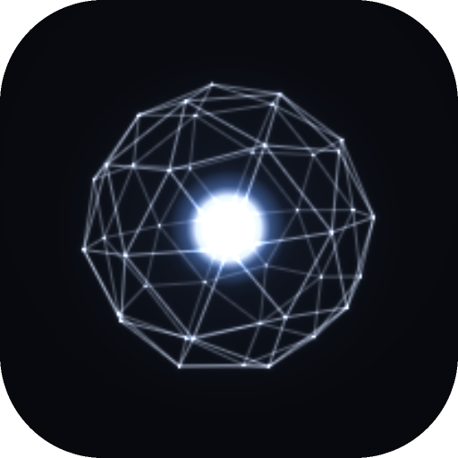
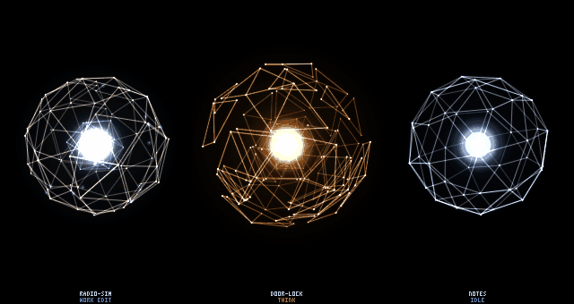
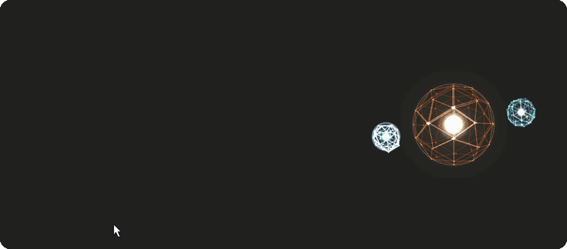
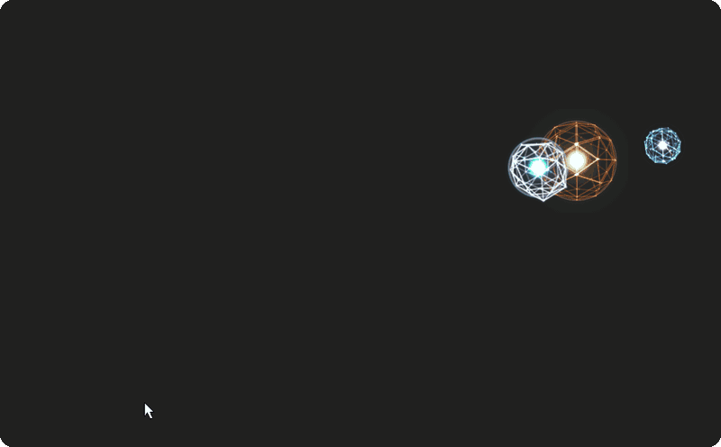
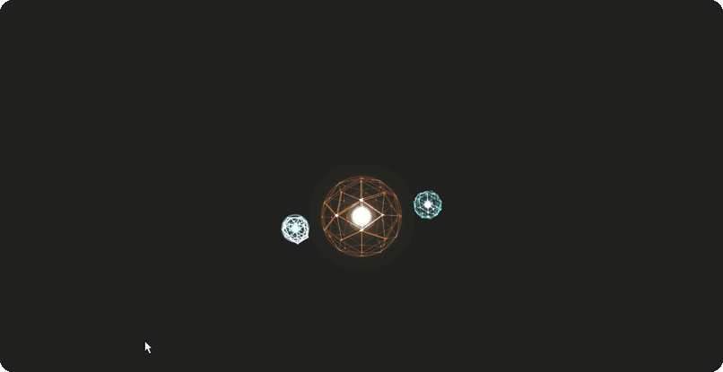
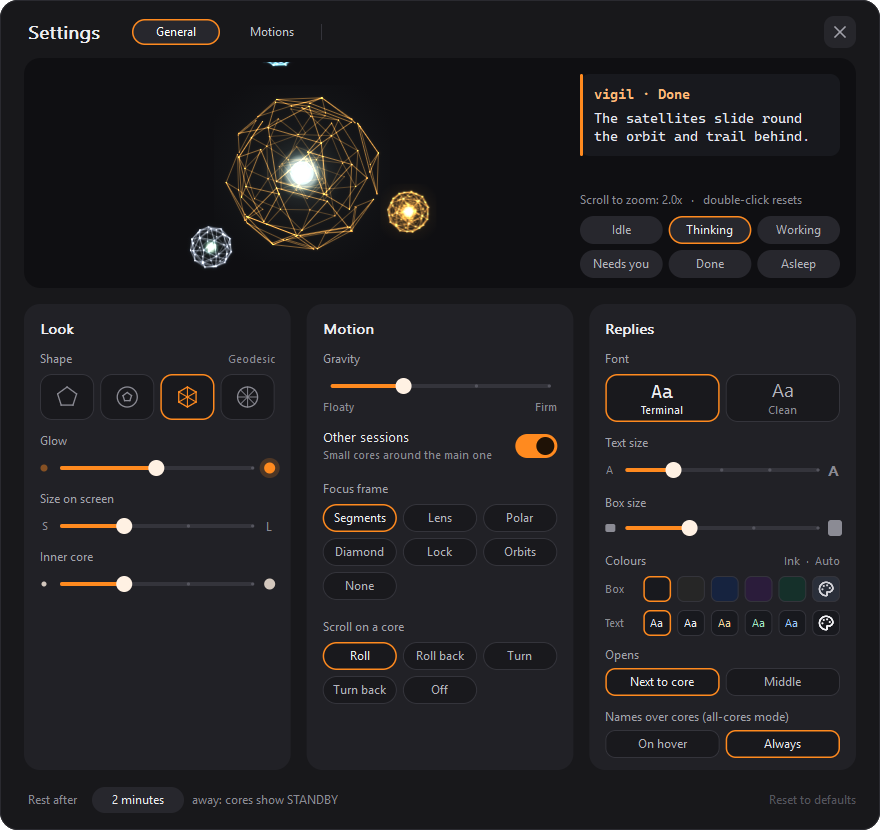
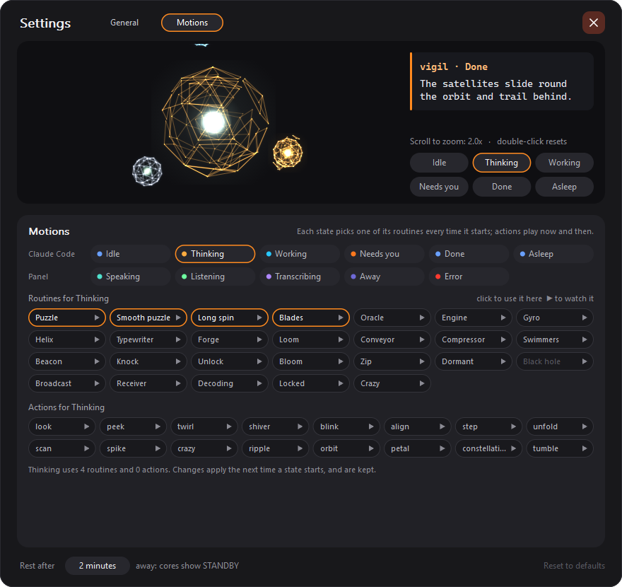

<p align="center"></p>

<h1 align="center">Vigil</h1>

<p align="center">
  A status display for Claude Code: each running session is a polyhedron whose colour and motion show what it is doing.
</p>

<p align="center">
  <b>English</b> · <a href="README.zh-TW.md">繁體中文</a>
</p>

<p align="center">
  
  
  
  <a href="LICENSE"></a>
</p>

<p align="center"></p>

When you run several Claude Code sessions, or leave one working while you do something else, Vigil shows which ones are thinking, running a tool, waiting for your approval or done. It runs in a terminal pane, or as a small always-on-top window on macOS and Windows.

In the window you can point at a session's core to read its last reply, and double-click it to type an answer, so you don't have to switch back to the terminal each time an agent finishes.

A Claude Code hook appends one line per event to a file; a C program reads the file and draws the cores with its own renderer. Everything runs locally, with no network access, and needs only libc, libm and zlib.

<sub>Formerly dodeca-core: the data folder `~/.dodeca-core` and the `DODECA_*` variables keep their old names for now.</sub>

<p align="center">
  <a href="#states">States</a> ·
  <a href="#quick-start">Quick start</a> ·
  <a href="#panels">Panels</a> ·
  <a href="#privacy">Privacy</a> ·
  <a href="#reference">Reference</a>
</p>

## States

<table>
  <tr>
    <td width="33%" align="center"><br><b>IDLE</b><br><sub>After start, or after finishing. Turns slowly; now and then does a small motion on its own</sub></td>
    <td width="33%" align="center"><br><b>THINK</b><br><sub>After a prompt or a tool result. Amber</sub></td>
    <td width="33%" align="center"><br><b>WORK</b><br><sub>While a tool runs. Cyan, sparks along the edges</sub></td>
  </tr>
  <tr>
    <td align="center"><br><b>NEEDS YOU</b><br><sub>Waiting for your approval. Orange, flickering core</sub></td>
    <td align="center"><br><b>DONE</b><br><sub>Claude finished replying. A short burst, then IDLE</sub></td>
    <td align="center"><br><b>SLEEP</b><br><sub>Idle for 90 s. Dims</sub></td>
  </tr>
</table>

Each state has several motions, and one is picked at random each time the state starts ([the full list](#reference)). A session is removed on `SessionEnd`, or after 30 minutes without events.

## Quick start

```sh
make
./vigil --demo                     # made-up sessions; q quits

python3 install_hooks.py           # dry run: shows what would change in ~/.claude/settings.json
python3 install_hooks.py --apply   # installs the hook (backs up your settings first)
./vigil                            # your sessions
```

- Needs a C compiler, `make`, zlib and Python 3 (standard library only). macOS: `xcode-select --install`. WSL: `sudo apt install build-essential zlib1g-dev`.
- Terminals that can show images (iTerm2, kitty, Ghostty, WezTerm) get full resolution; other truecolor terminals get half-block characters.
- The hook applies to sessions started after installing it. It is called by absolute path, so run `--apply` again if you move this folder. `--remove` uninstalls it.
- `--rich` also keeps Claude's last reply, which the panels need for the text box and voice. Off by default; see [Privacy](#privacy).

## Panels

A small window that stays above other windows, never takes keyboard focus, and lets clicks through except on a core.

```sh
sh mac/build.sh && ./vigil-panel --demo     # macOS
sh win/build.sh && ./vigil-win --demo       # Windows: run from WSL (needs mingw-w64)
```

<p align="center"><br>
<sub>Point at a core to see its last reply, or the approval it is waiting for. After 2 s the focus frame locks on.</sub></p>

<p align="center"><br>
<sub>The wheel scrolls a long reply. Double-click opens a reply box; an image dragged onto the core is added as <code>[Image #1]</code>. Enter sends it to that session.</sub></p>

<p align="center"><br>
<sub>Alt-click picks the cores up, and the small ones follow on their orbit. Move too fast and they drop off and bounce off the screen edge; bring the main core close to one and it returns to its orbit. Gravity: Floaty.</sub></p>

- **One core or all.** In single-core mode one large core shows the session that needs you (else the one with the newest reply), and the other sessions are small cores around it; in all-cores mode each session is its own core. The Windows panel starts in single-core mode (`--all` for all cores, each placed where you like); the macOS panel starts with all cores in a column on the right edge (`--single` or `⌃⌥C` for single-core mode).
- **Replying.** Double-click a core, type, Enter; images can be dropped on the core. On macOS you can also hold a core and speak (push-to-talk, recognised on the Mac); the text goes into that session's iTerm2 pane.
- **Spoken reports** (macOS, `--voice`): clicking a core reads a short summary of its reply.
- **Settings** (Windows: right-click > Settings): shape, glow, size, gravity, focus frame, which way the wheel spins a core, the text box's font, size, box and text colours, and which motions each state uses, with a live preview. The Mac has the same window (right-click > Settings...), with a Voice row added; there the wheel keeps setting the speech volume and ⌥ + the wheel spins the core (see below).

<table>
  <tr>
    <td width="50%"></td>
    <td width="50%"> Motions: the routines and actions each state may run"></td>
  </tr>
</table>

<p align="center"><sub>The Windows panel's Settings window, General and Motions, with the preview zoomed to 2×.</sub></p>

## Privacy

The event file contains only time, session id, event name, folder name (no path), tool name and notification type. Prompts and tool input/output are never recorded. No network connections, no background daemon, and the file's permissions are 600.

With `DODECA_RICH=1` (`install_hooks.py --rich`) the hook also keeps one file per session in `~/.dodeca-core/msg/<session id>.json` (mode 600, folder 700): **the text of Claude's last reply** and of the last notification (e.g. a permission prompt), at most 4000 characters each, and the `ITERM_SESSION_ID` of the terminal it runs in. Each new reply or notice replaces the old one, the file is deleted when the session ends, and files left by sessions that never ended are deleted after 24 hours. The event file stays the same apart from `"m": 1` on a `Stop` line. Since reply text is written to disk, turn this on only on your own machine.

Voice (`vigil-panel --voice`): speech is synthesized on this Mac, and push-to-talk recognition is on-device only, so recordings never leave the Mac and are not kept. The recognized text is typed into the Claude Code session it was meant for, like anything you type. The one network use is `--summarize claude`, which sends the reply text to Anthropic through `claude -p` to shorten it.

## Reference

<details>
<summary><b>Every motion</b></summary>

| State | Triggered by | Looks like |
|---|---|---|
| IDLE | `SessionStart`, after finishing | A calm, exact sphere: white core, blue glow, slow rotation; now and then a line of light climbs it, and every few seconds it does something on its own (glances, peeks, twirls, blinks, turns a vertex toward you, snaps a step, unfolds, scans, spikes, sends a ripple over itself, flies one patch round itself, opens like a flower round the node facing you, lights a chain of nodes, tumbles half a turn, and rarely a whole crazy fit) |
| THINK | `UserPromptSubmit`, `PostToolUse` | Amber. One of: **Puzzle** (one layer of the shell rises in separate pieces and the two layers turn against each other like a cube being solved, two quick turns and a halt, three times), **Smooth puzzle** (the same with eased turns), **Long spin** (each layer spins three full turns in turn), **Blades** (single triangles float out behind the core and smash across the front in pairs like a volley of arrows) |
| WORK | `PreToolUse` | Electric cyan, sparks run along the edges. One of: **Engine** (a turbine belt and pistons firing in order), **Gyro** (two belts at right angles), **Helix** (a spiral of lifted patches climbs the turning shell), **Typewriter** (rows of keys and a carriage return), **Forge** (pieces rise glowing and strike: sparks and embers), **Loom** (a shuttle lays a light thread across two crossing belts), **Conveyor** (two rings step a slot at a time), **Compressor** (squeezed flat in three clicks, then it vents) |
| NEEDS YOU | `Notification` (except idle reminders) | Orange, the core flickers like a glitch. One of: **Swimmers** (two "fish" of small patches swim just under the surface), **Beacon** (a lighthouse beam that flares each time it faces you), **Knock** (two taps toward you, a ring each) |
| DONE | `Stop` | One of: **Unlock** (charges, bursts open with spikes and a ring, turns a full circle, the patches lock back one by one), **Bloom** (opens like a flower ring by ring, turns once, folds back and seals), **Zip** (a zipper head runs down a spiral snapping the patches shut, then sparks fountain); back to IDLE after 2.5 s (Bloom and Zip take a little longer) |
| SLEEP | IDLE for more than 90 s | Everything dims. One of: **Dormant** (draws in a little; a faint scan every 6 s), **Black hole** (gathers power, bursts apart, the pieces fall back on a spiral into a void with a violet dust disc; pointing at it wakes it) |

Each time a state starts it picks one of its motions at random (the panel's Settings choose which; see Motions below). The shell never bends or wobbles: it moves in snap turns, patches of triangles that slide out and lock back (cut at random each time, so no pattern repeats), layers turning against the rest, pieces carried off whole, and spikes, where a node is pulled far out into a sharp pyramid while another is pulled in toward the centre, with sparks, light trails and rings. The panel's own states move too: SPEAKING (patches rise and fall with the voice), LISTENING (the front opens with the microphone), TRANSCRIBING (36° steps while a scan plane reads it), STANDBY (still, square to you), ERROR (goes crazy in fits). Patches need the geodesic shells (`geo2`, the default, or `geo3`); `dodeca` and `bucky` keep a rigid net with turns, spikes and light only.

`SessionEnd` removes that session's polyhedron. Sessions with no events for 30 minutes are removed too.

</details>

<details>
<summary><b>Floating panel (macOS)</b></summary>

`vigil-panel` is a native-window version using the same rendering core: a borderless panel pinned to the right edge of the screen. It doesn't take keyboard focus, mouse clicks pass through it (except on a core, see below), and dark areas are transparent, so it can float over a full-screen iTerm2. The system composites it directly, without going through the terminal.

```sh
sh mac/build.sh
./vigil-panel --demo              # try it on its own first, Ctrl-C to quit
```

`mac/build.sh` makes `Vigil.app` and a small launcher script `./vigil-panel`. The launcher starts the app through macOS (so the microphone and speech permissions used by the voice features belong to the app, not to your terminal), stays in the terminal until the app quits, and takes the same options. Ctrl-C or closing the terminal pane ends both. The app is signed ad-hoc, which changes with every build, so macOS asks for its permissions again after a rebuild; to avoid that, create a "Code Signing" certificate in Keychain Access once and build with `DODECA_SIGN_ID="certificate name" sh mac/build.sh`.

Once built, `open_pane.sh` uses it automatically: the iTerm2 pane split off to the right stays blank and just reserves the space; the panel starts inside it, measures the pane and sits right on top of it. Closing that pane ends the panel; 15 seconds after the last session ends, the panel and pane close together.

- The panel stays on the Space it was started on, i.e. the full-screen iTerm2 window that launched it; it doesn't follow you to other desktops or apps.
- `--all-spaces` makes it appear on every Space, shown only while iTerm2 is the frontmost app (add `--always` to drop that condition).
- If you switch to an iTerm2 tab without the blank pane, the panel still floats on the right edge and may cover text; use `--bg 1e1e1e` to give it a solid background if that bothers you.
- When run by hand, the panel is 17% of the screen width. Use `--width` (in points) and `--top` to position it, and `--inset` for the space above the first session (default 30). When started by `open_pane.sh` it gets `--fit-pane`, which sizes it to the blank pane.
- The font defaults to Monaco 12; use `--font` and `--font-size` to match your iTerm2 settings.
- To go back to the terminal-pane version: `export DODECA_PANE_MODE=terminal`.
- The cores react to the mouse and to a hotkey: see [Interaction and voice](#reference).

</details>

<details>
<summary><b>Interaction and voice (macOS panel)</b></summary>

The cores in `vigil-panel` react to the mouse and to a global hotkey. The panel still never takes keyboard focus from iTerm2, and clicks outside a core's round shell still go through to the terminal. Speaking and push-to-talk are off unless you start it with `--voice`; without it a click only marks the reply as read and holding a core does nothing. `./vigil-panel --demo --voice` lets you try everything below with made-up sessions (add `--away 10` to see standby quickly).

| Input | Does | The core |
|---|---|---|
| Point at it | Tooltip after 0.3 s, to the left of the panel: folder, state and the last reply laid out as in the terminal, up to 16 lines (the notification text while NEEDS YOU) | Brightens, spins slower, turns toward the cursor, and answers in its state's own way: IDLE stirs (calm spikes on your side), THINK lights the nodes under the pointer, WORK's pistons fire harder, NEEDS YOU's fish swim toward you, TRANSCRIBING's scan follows you, SLEEP and STANDBY wake, ERROR jerks away |
| Rest on it 2 s | — | Lock-on: it stops with a vertex toward you and a focus frame closes in (Settings > Focus frame: segments, lens, polar, diamond, lock, orbits or none) |
| Rush at it | — | Only from well away (over 2.2 shell radii) onto the core within 0.18 s: the patches clamp shut, a spike shoots toward where you came from, the shell jerks. Not while working |
| Unread reply | — | A slow, soft flash until you click it or send a new prompt |
| Click | Speaks the report, or stops it; marks the reply as read | The patch you clicked goes in and the press travels out through its neighbours; then SPEAKING (teal) |
| Hold (> 0.35 s), release | Push-to-talk: what you say is shown under the core for 1.5 s, then typed into that session with Return; click the core in that time to cancel | LISTENING while held (green, shell stops, glow follows the microphone), then TRANSCRIBING (violet sparks racing along the edges) |
| Double-click | Opens a reply box under the core's tooltip: type, Enter sends it to that session (Shift+Enter: a new line; the pane gets it as one line), Esc or its ✕ closes it and keeps the draft; it stays open when you click elsewhere, so you can pick up an image in Finder or the screenshot thumbnail. Images dropped on the core or the box, or pasted with ⌘V, each put an `[Image #N]` token at the cursor, as in Claude Code; Backspace takes a whole token, and on send each token becomes the image's path. While Claude is working it asks first, as for a spoken reply | One shockwave ring; a core with images dragged over it reads them (TRANSCRIBING) |
| Right-click | Menu: Replay, Copy reply, Mute this session, Bring to front, and **Settings...**, the Settings window: a live preview (drag its core, scroll on it to zoom, buttons for each state, a reply in the text box's look), **Look** (shape, glow, size on screen, inner core), **Motion** (gravity, other sessions on or off, focus frame, what ⌥ + scroll does), **Replies** (the text box's font, text size, box size, box and text colours, where it opens, names over cores), **Voice** (spoken reports, read new replies aloud, summaries by Claude, wait before sending) and the rest time; its **Motions** page chooses which routines and actions each state may use (▶ plays one in the preview). Choices apply at once, are saved in `~/.dodeca-core/panel-settings.json` and win over the launch options; Reset to defaults forgets them. With no session running, right-click shows Settings only | — |
| Drag | Turns the polyhedron by hand; let go while moving and it spins on, slowing back to its own rotation | — |
| Scroll | This core's speech volume (scrolling does not turn the core on the Mac) | The shell gets thicker or thinner for a moment |
| ⌥ + scroll | Spins the core: Roll (the top goes away as you scroll down), Roll back, Turn (round the upright axis), Turn back, or Off, as Settings > Motion > ⌥ + scroll on a core says | It spins on and slows back to its own rotation, as after a drag |
| Esc while recording | Cancels; nothing is sent | Glow shrinks and fades back |
| `⌃⌥V` (hold, with `--voice`) | Push-to-talk to the session that needs you most: NEEDS YOU, else the one that finished last, else the one active last | as holding the core |
| No keyboard or mouse input for 2 minutes | — | Every core except NEEDS YOU goes to STANDBY (dim indigo); when you come back, cores with an unread reply flare once |

- **Single-core mode** (`--single`, or `⌃⌥C` at any time; `--mode-hotkey` changes the key): one large core for one session, and the others as small cores floating around it. Each session's core is tinted with its own colour, so you can tell who is who; the shell keeps the state colours. The panel shrinks to just this cluster: ⌥-drag it anywhere on the screen (or ⌥-click it: it rides on the mouse until the next click puts it down; the pointer hides, the focus frame holds it, the core leans into the motion, lags a little and settles when you stop or turn (no bounce), the patches on the trailing side open, the small cores trail behind, and a hard shake makes it go crazy; the small cores are held on their orbit by gravity (Settings > Motion > Gravity, Floaty to Firm), slide round to the trailing side while you carry, and a very fast carry flings them off: they fly on, bouncing off the screen's edges, until you bring the main core close), and it comes back there next time (saved per screen size in `~/.dodeca-core/panel-position.json`; right-click > Reset position puts it back on the right edge). Click a small core and it swaps into the middle and stays there (the tooltip says "pinned"); right-click > Follow automatically lets the panel choose again. On its own the middle follows the news: a session that needs you, else the one with the newest reply; it does not jump around just because sessions are busy. Push-to-talk with the hotkey goes to the core in the middle. The right-click menu also switches modes.
- `⌥`-drag a core up or down to reorder the column (in the all-cores mode): the core follows the mouse and the others make room. An ⌥-click picks the core up without holding the button; the next click puts it down.
- `--labels hover` leaves out the two lines of text above each core, so the panel shows only the cores (larger, since they get that space) and the tooltip says which is which.
- The tooltip and the recognized-text preview appear to the left of the panel, over the terminal, and wrap their text instead of cutting it off; the preview shows everything that will be sent. The title is in the session's colour (its state colour, or its own colour in single-core mode) with a bar of that colour down the left edge; the text is in the system font at `--font-size`, laid out like Claude Code's terminal: paragraphs apart, `-` items as bullets with wrapped lines indented, **bold**, `code` in a monospaced font, code blocks indented.
- A single click waits for the system's double-click time before it acts, so a double click never starts with a single one.
- Hotkeys use `RegisterEventHotKey`, which needs no Accessibility permission. Esc is only taken while recording, so the terminal keeps it otherwise. `--hotkey ctrl+opt+v` changes the push-to-talk key (`cmd`, `opt`, `ctrl`, `shift` plus a letter, digit, `space`, `return`, `tab` or `f1`–`f12`; `none` turns it off). macOS already uses ⌃Space, ⌃⌥Space, ⌘Space and ⌥⌘Space, so the default is `⌃⌥V`.
- Away is read from the system's "seconds since last input" (no Input Monitoring permission, no key logging). `--away SECONDS` changes the 120 s; `--away 0` turns it off.
- Sending a reply and "Bring to front" need `DODECA_RICH` (the iTerm2 session id is kept in the msg file) and, the first time, your OK for the panel to control iTerm2 (System Settings > Privacy & Security > Automation).

**Spoken reports.** A report starts with where it comes from: "notes 完成了：…" for a reply, "notes 需要你：…" with the permission request while a session needs you. Only one session speaks at a time, others wait their turn, and a permission request goes to the front of the queue.

- By default the panel speaks only when you click a core or choose Replay. With `--auto-speak` it also reads a new reply out on its own if you used the keyboard or mouse in the last 60 seconds, and reads a new permission request out at once. Muted sessions never speak on their own.
- What is read is a summary. By default the first paragraph of the reply, at most 3 sentences or 150 characters (no cost, no delay). With `--summarize claude` the panel asks `claude -p` (model haiku, hooks and tools off) in the background for two or three conversational sentences in Traditional Chinese; if that takes more than 15 seconds it uses the local summary. The summary is kept in the msg file, so Replay doesn't ask again. This sends the reply text to Anthropic once more and uses your Claude Code quota.
- Before reading, code blocks become "（略過一段程式碼）", and Markdown symbols and URLs are removed (links keep their text).
- The voice is the **System Voice** of System Settings > Accessibility > Spoken Content. Set it to a **Siri** voice: it is the only kind that reads Chinese with English words in it naturally, and apps can reach it only this way (the panel renders each sentence with `say` and plays it, so the first sound comes about a second after the click). `--voice-id zh-TW` (or `en-US`, or a voice identifier) uses a voice apps may choose directly instead: it starts at once, and the best installed one is picked (download **Meijia (Premium)** under Manage Voices for zh-TW), but English words inside Chinese sound poor. `--rate` sets the speed (0 to 1, default 0.5). The panel's own words are in Chinese when your macOS language is Chinese.
- Speaking needs no permission.

**Voice replies.** Hold a core (or `⌃⌥V`), speak, let go.

- Recognition runs on this Mac only (`SFSpeechRecognizer` with on-device recognition required): the recording is never uploaded. If the language has no on-device model, push-to-talk is turned off and the core says why. `--listen-locale` sets the language (default `zh-TW`).
- The recognized text appears under the core. After 1.5 seconds it is typed into that session's iTerm2 pane, followed by Return; click the core before then to cancel. With `--confirm-send` it waits instead, and a second click sends it.
- If Claude is still working, the panel asks first ("還在工作中，要打斷嗎？") with a menu: send after this step (Claude Code reads it when the current step ends), interrupt and send (Esc first), or cancel.
- If the pane can't be found, the core turns red (ERROR) and says why.
- It listens with the system's input device, except a virtual one (BlackHole, Loopback, Soundflower, Teams or Zoom audio), which carries other apps' sound rather than your voice: then it uses the built-in microphone. `--mic NAME` picks a device by part of its name. If a recording is completely silent, the core says which device it used.
- `--debug` writes each voice step to stderr (device, levels, recognizer errors, send result; never what you said).
- Sending needs `DODECA_RICH` (the session's `ITERM_SESSION_ID` is kept in the msg file). It uses AppleScript, which asks once for permission to control iTerm2; if that is not allowed, it falls back to iTerm2's Python API (`pane_api.py send`).
- In `--demo` nothing is typed anywhere; the core only says what it would have sent.

**One-time setup for voice:**

1. `sh mac/build.sh`, then start the panel with `--voice` (`DODECA_PANE_ARGS="--voice"` for the pane opened by `open_pane.sh`).
2. `python3 install_hooks.py --rich --apply`, so replies and the iTerm2 session id are kept (start new Claude Code sessions afterwards).
3. The first time you hold a core, macOS asks for the microphone and for speech recognition: allow both, then hold again.
4. The first time a reply is sent or you choose Bring to front, macOS asks whether Vigil may control iTerm2: allow it (System Settings > Privacy & Security > Automation).
5. Optional: a better zh-TW voice (System Settings > Accessibility > Spoken Content > System Voice > Manage Voices); iTerm2 > Settings > General > Magic > Enable Python API, as the fallback for sending.
- How each reaction looks is set in `src/session.c`: `LOOKS` (the SPEAKING, LISTENING, TRANSCRIBING and STANDBY rows), `HOVER` and `TOUCH`.

</details>

<details>
<summary><b>Windows panel</b></summary>

On Windows, run Claude Code inside WSL; the hook and the terminal version work there as on Linux (`sudo apt install build-essential zlib1g-dev`, then `make` and `python3 install_hooks.py --rich --apply` in WSL). The floating panel is a native Windows program that reads the same events file through WSL's `\\wsl.localhost` share:

```sh
sudo apt install mingw-w64      # once, in WSL
sh win/build.sh                 # builds vigil-panel.exe and the launcher ./vigil-win
./vigil-win                     # from WSL: starts the panel on ~/.dodeca-core/events.jsonl; Ctrl-C quits
./vigil-win --demo              # made-up sessions
```

By default it is in single-core mode (on the Mac that takes `--single`): one big core for the session in focus with the other sessions as small satellites around it, in a small see-through window, always on top, never taking focus, and clicks outside the core go through to the windows behind. The core follows the news like the macOS single-core mode (a session that needs you, else the newest reply); a click on a core, or the right-click menu's **Session**, pins one. Turning off **Show other sessions** (or `--no-others`) leaves only the big core. `--all` or **Ctrl+Alt+C** switches to all cores: each core is its own small window, starting in a column on the right edge, and you can put each one anywhere.

Alt does what ⌥ does on the Mac: **Alt-drag** moves the cluster (single core) or that one core (all cores) anywhere on the screen; **Alt-click** picks it up, and the next click anywhere puts it down. Places are kept per screen size in `~/.dodeca-core/panel-position-win.json` (each core by its folder name), and **Reset position(s)** in the menu forgets them.

Pointing at a core for a moment shows the text box: name and state, then the last reply, or the permission notice while it needs you (with `--rich` hooks). Resting on a core for 2 s, or carrying it, draws the focus frame (six styles, as on the Mac). With no input for a while (2 minutes by default) every core shows STANDBY, except one that needs you; back again, unread replies flash. The mouse wheel over a core scrolls a long reply in its box (and spins the core).

**Double-click** a core to type an answer under its box: Enter sends it, Shift+Enter starts a new line, Esc closes it and keeps the draft. Drag image files (png, jpg, gif, webp) onto a core or that box to send them along: the core reads them (TRANSCRIBING) while they are over it, and each one puts an `[Image #N]` token where the cursor is, as in Claude Code; move or delete it like any text (Backspace takes a whole token). On send each token becomes the image's WSL path (`/mnt/c/...`) in its place, which Claude Code reads as an image. It goes into the session's tmux pane when Claude Code runs inside tmux in WSL (the `--rich` hook notes the pane); otherwise the terminal comes to the front and the text is typed into it, on one line.

Right-click a core for **Reply**, **Copy reply** and **Bring to front**: there is no iTerm2 here, so that brings up the terminal or VS Code window with the folder name in its title, else the Windows Terminal window used last, but cannot pick the tab.

Right-click > **Settings...** opens the Settings window: a live preview across the top (the cluster as it will look; drag its core to feel the gravity; scroll on it to zoom in up to 3x, double-click to zoom back; buttons to show it in each state; a reply in the text box's font and size) and three cards below. **Look**: shape, glow, size on screen, inner core. **Motion**: what scrolling on a core does (Roll, Roll back, Turn, Turn back or Off), gravity (Floaty to Firm: how hard the main core holds the small cores on their orbit; carried, they slide round it and trail behind, and a hard fling sends them bouncing off the screen edges), other sessions on or off, focus frame. **Replies**: the text box's colours: Box (five dark tones) and Text (Auto, White, Cream, Mint, Sky), each with a palette swatch that opens the Windows colour window for any colour (on Auto, text on a light box turns dark); the box's size; its font (the terminal's monospaced face, so a reply lines up as it does in Claude Code, Chinese in Microsoft JhengHei two cells wide as in Windows Terminal; or Segoe UI; the reply box always types in the terminal's face), text size, where it opens (next to the core, or the middle of the screen), and names over the cores in all-cores mode.

The **Motions** page (the switch at the top) chooses, for every state, which routines it may run (one is picked each time the state starts; any routine may go to any state, except the black hole, which is for sleep only) and which actions it may play now and then while left alone; **▶** on a chip plays it in the preview. At the foot: how long until the cores rest (STANDBY) and **Reset to defaults**. Choices apply at once, are kept in `~/.dodeca-core/panel-settings-win.json` and win over the launch options until reset; Esc closes the window.

Also there: all the motion, lock-on, the rush defence, the press, drag to spin, the double-click ring. Not yet: voice; the iTerm2 features have no Windows counterpart. Windows Terminal cannot show the kitty or iTerm2 images, so the terminal version draws with half-block cells there.

</details>

<details>
<summary><b>iTerm2 side pane</b></summary>

`--pane` is a vertical layout for narrow panes: sessions stack top to bottom, each with two lines of text (name, state) above its polyhedron. The text uses the terminal's own font, so it's the same size as other panes using the same profile.

```sh
./vigil --pane --demo                # try it in a narrow pane first
python3 install_hooks.py --pane --apply    # open the pane automatically whenever Claude Code starts
```

When installed with `--pane`, `SessionStart` also runs `open_pane.sh`: it splits a pane off to the right of Claude Code's pane, runs `vigil --pane --exit-when-empty` in it, shrinks it to 34 columns, and gives keyboard focus back to Claude Code. If a pane is already open it won't open another; the pane closes itself 15 seconds after the last session ends.

- Pane width: environment variable `DODECA_PANE_COLS` (default 34).
- Shrinking the pane needs iTerm2's Python API (`pane_api.py`): AppleScript can split panes but can't resize them in a full-screen window. Two one-time steps: enable Settings > General > Magic > Enable Python API in iTerm2, then copy the script to iTerm2's scripts folder: `mkdir -p ~/Library/Application\ Support/iTerm2/Scripts && cp pane_api.py ~/Library/Application\ Support/iTerm2/Scripts/vigil_pane.py` (after that, `open_pane.sh` keeps the copy up to date). Without this the pane is half the width; you can drag the divider yourself and the display follows.
- Debugging: `DODECA_PANE_DEBUG=1 sh open_pane.sh` runs in the foreground and shows iTerm2's responses.
- Extra arguments: environment variable `DODECA_PANE_ARGS`, e.g. `"--shape geo2 --res 1200"`.
- The first time it runs, macOS asks whether to allow controlling iTerm2; click Allow.
- If you don't want it opened automatically, split a pane yourself and run `./vigil --pane`.

</details>

<details>
<summary><b>Output modes</b></summary>

The program first draws an RGB image in memory, then sends it to the terminal in one of three ways, detected automatically at startup:

| Mode | Description |
|---|---|
| `--kitty` | kitty graphics protocol, real pixels. Preferred when the terminal reports support |
| `--iterm` | iTerm2 inline images (PNG), real pixels. Used inside iTerm2 when the above isn't supported |
| `--cells` | Half-block characters `▀`, two pixels per character cell. Works in any truecolor terminal but is coarse; always used inside tmux |

If auto-detection picks poorly, force a mode with the flag.

</details>

<details>
<summary><b>Options</b></summary>

```
--pane            vertical layout for a side pane
--exit-when-empty exit after 15 s with no sessions
--demo [N]        use N fake sessions (1-6, default 3)
--shape NAME      dodeca | bucky | geo2 (default) | geo3
--res N           pixels on the image's longest side (default 960, 420 with --pane; higher is finer but heavier on the terminal)
--fps N           max frames per second (default 20; calm sessions redraw less often automatically)
--glow X          glow strength (default 1.0)
--core X          core radius as a fraction of the shell's inscribed-sphere radius (default 0.35)
--events PATH     event file (default ~/.dodeca-core/events.jsonl, or env var DODECA_EVENTS)
--snapshot FILE   write one demo frame as a PPM file and exit (with --at seconds, --size WxH)
```

</details>

<details>
<summary><b>Architecture</b></summary>

```
Claude Code ──hook.py──▶ ~/.dodeca-core/events.jsonl ──tail──▶ state machine ──▶ software renderer ──▶ terminal
```

| File | Contents |
|---|---|
| `mac/panel.m` | Floating panel: Cocoa window, text labels, turning the canvas into a transparent image |
| `pane_api.py` | Splits panes and sets their width via the iTerm2 Python API |
| `open_pane.sh` | `SessionStart` hook: automatically splits off a side pane in iTerm2 |
| `hook.py` | Appends one JSON line per event: time, session id, event name, folder name, tool name, notification type |
| `src/events.c` | Follows the event file and reads new lines |
| `src/session.c` | Maps events to states, plus the per-state appearance table `LOOKS` |
| `src/geom.c` | Generates vertices and edges for the dodecahedron, truncated icosahedron and geodesic spheres |
| `src/render.c` | Draws lines, glow, core and labels into a float RGB canvas |
| `src/motion.c` | How each state moves: snap turns, patches, spikes, one routine per motion, the idle whims |
| `win/panel.c` | The Windows panel: layered windows, orbit physics, Settings window |
| `src/main.c` | Main loop, terminal setup, the three output modes, demo |

Colours are the `LOOKS` table in `src/session.c`; how each state moves is a routine in `src/motion.c`.

</details>

<details>
<summary><b>Known limitations</b></summary>

- After you approve a permission request, Claude Code doesn't send another event, so the session keeps showing NEEDS YOU while that tool runs and only switches once the tool finishes.
- Labels use a built-in 3×5 bitmap font with only letters, digits and a few symbols; non-ASCII characters in folder names (e.g. Chinese) show as `?`.

</details>

## Credits and license

Vigil is made by **Zaviel** ([zelvet-velvet](https://github.com/zelvet-velvet)): the living cores and the Core Bestiary motion, the Windows panel, single-core mode and carrying, the interactions, voice, and the Settings window.

It grew out of **dodeca-core** by **Shang-En Hsu** ([Ehsu745](https://github.com/Ehsu745/dodeca-core-cc-status)), who wrote the first polyhedron renderer, the terminal output modes, the first macOS floating panel and the iTerm2 side pane. dodeca-core itself started from Zaviel's [clawd-room](https://github.com/zelvet-velvet/clawd-room): `hook.py`, `install_hooks.py` and the event reading in `src/events.c` are adapted from it.

MIT License; [LICENSE](LICENSE) keeps both copyright lines.
