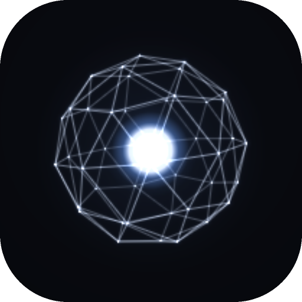
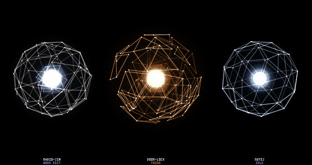
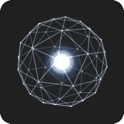
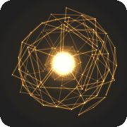
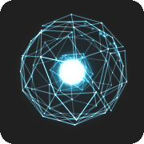
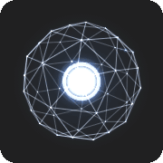
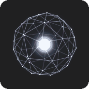
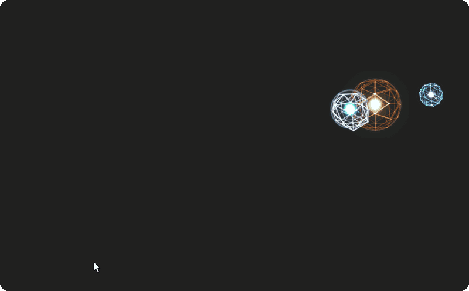
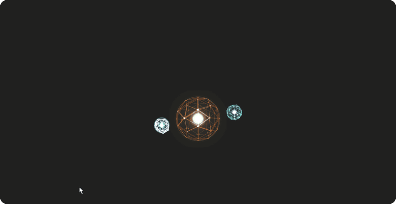
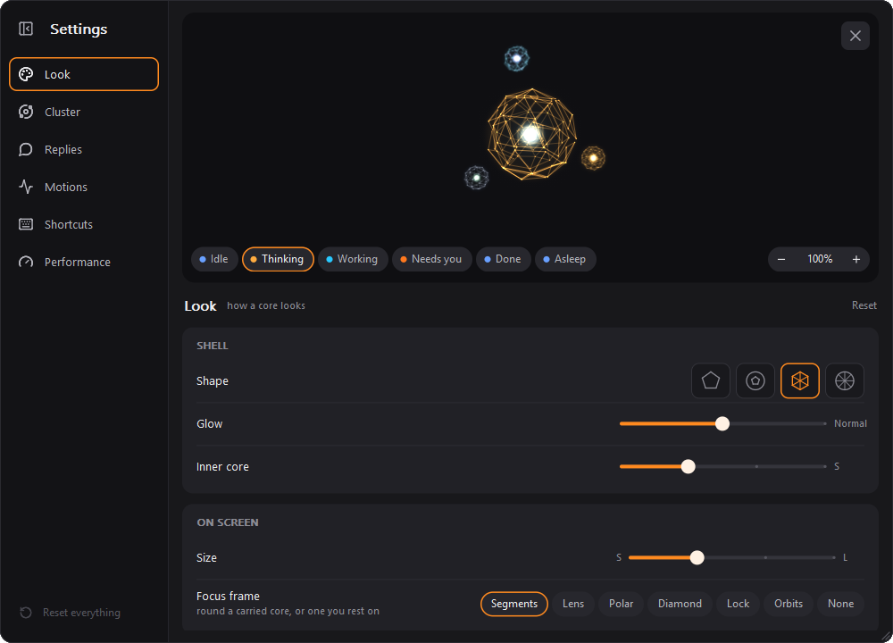

<p align="center"></p>

<h1 align="center">Vigil</h1>

<p align="center">
  A status display for Claude Code: each running session is a polyhedron whose colour and motion show what it is doing.
</p>

<p align="center">
  <b>English</b> · <a href="README.zh-TW.md">繁體中文</a>
</p>

<p align="center">
  
  
  
  <a href="LICENSE"></a>
</p>

<p align="center"></p>

When you run several Claude Code sessions, or leave one working while you do something else, Vigil shows which ones are thinking, running a tool, waiting for your approval or done. It runs in a terminal pane, or as a small always-on-top window on macOS and Windows.

In the window you can point at a session's core to read its last reply, and double-click it to type an answer, so you don't have to switch back to the terminal each time an agent finishes.

A Claude Code hook appends one line per event to a file; a C program reads the file and draws the cores with its own renderer. Everything runs locally, with no network access, and needs only libc, libm and zlib.

<sub>Formerly dodeca-core: the data folder `~/.dodeca-core` and the `DODECA_*` variables keep their old names for now.</sub>

<p align="center">
  <a href="#states">States</a> ·
  <a href="#quick-start">Quick start</a> ·
  <a href="#panels">Panels</a> ·
  <a href="#privacy">Privacy</a> ·
  <a href="#reference">Reference</a>
</p>

## States

<table>
  <tr>
    <td width="33%" align="center"><br><b>IDLE</b><br><sub>After start, or after finishing. Turns slowly; now and then does a small motion on its own</sub></td>
    <td width="33%" align="center"><br><b>THINK</b><br><sub>After a prompt or a tool result. Amber</sub></td>
    <td width="33%" align="center"><br><b>WORK</b><br><sub>While a tool runs. Cyan, sparks along the edges</sub></td>
  </tr>
  <tr>
    <td align="center"><br><b>NEEDS YOU</b><br><sub>Waiting for your approval. Orange, flickering core</sub></td>
    <td align="center"><br><b>DONE</b><br><sub>Claude finished replying. A short burst, then IDLE</sub></td>
    <td align="center"><br><b>SLEEP</b><br><sub>Idle for 90 s. Dims</sub></td>
  </tr>
</table>

Each state has several motions, and one is picked at random each time the state starts ([the full list](#reference)). A session is removed on `SessionEnd`, or after 30 minutes without events.

## Quick start

```sh
make
./vigil --demo                     # made-up sessions; q quits

python3 install_hooks.py           # dry run: shows what would change in ~/.claude/settings.json
python3 install_hooks.py --apply   # installs the hook (backs up your settings first)
./vigil                            # your sessions
```

- Needs a C compiler, `make`, zlib and Python 3 (standard library only). macOS: `xcode-select --install`. WSL: `sudo apt install build-essential zlib1g-dev`.
- Terminals that can show images (iTerm2, kitty, Ghostty, WezTerm) get full resolution; other truecolor terminals get half-block characters.
- The hook applies to sessions started after installing it. It is called by absolute path, so run `--apply` again if you move this folder. `--remove` uninstalls it.
- `--rich` also keeps Claude's last reply and the last few turns (your prompts, replies and short step details), which the panels need for the chat box and voice. Off by default; see [Privacy](#privacy).

## Panels

A small window that stays above other windows, never takes keyboard focus, and lets clicks through except on a core.

```sh
sh mac/build.sh && ./vigil-panel --demo     # macOS
sh win/build.sh && ./vigil-win --demo       # Windows: run from WSL (needs mingw-w64)
```

<p align="center"><br>
<sub>Point at a core to see its last reply, or the approval it is waiting for. After 2 s the focus frame locks on.</sub></p>

<p align="center"><br>
<sub>The wheel scrolls a long reply. Double-click opens a reply box; an image dragged onto the core is added as <code>[Image #1]</code>. Enter sends it to that session.</sub></p>

<p align="center"><br>
<sub>Alt-click picks the cores up, and the small ones follow on their orbit. Move too fast and they drop off and bounce off the screen edge; bring the main core close to one and it returns to its orbit. Gravity: Floaty.</sub></p>

- **One core or all.** In single-core mode one large core shows the session that needs you (else the one with the newest reply), and the other sessions are small cores around it; in all-cores mode each session is its own core. The Windows panel starts in single-core mode (`--all` for all cores, each placed where you like); the macOS panel starts with all cores in a column on the right edge (`--single` or `⌃⌥C` for single-core mode).
- **Replying.** Double-click a core, type, Enter; images can be dropped on the core. On macOS you can also hold a core and speak (push-to-talk, recognised on the Mac); the text goes into that session's iTerm2 pane.
- **Spoken reports** (macOS, `--voice`): clicking a core reads a short summary of its reply.
- **Settings** (Windows: right-click > Settings): a resizable window with a live, zoomable preview and six pages (Look, Cluster, Replies, Motions, Shortcuts, Performance): shape, glow, size, gravity, focus frame, the chat box's font and colours, which motions each state uses, and global hotkeys you can record. The Mac has a similar, simpler window (right-click > Settings...), with a Voice row added; there the wheel keeps setting the speech volume and ⌥ + the wheel spins the core (see below).

<table>
  <tr>
    <td width="50%"> Look: the sidebar of pages, the live preview, and rows of settings"></td>
    <td width="50%"> Motions: every state with its routines, and the chosen state's routines and actions"></td>
  </tr>
</table>

<p align="center"><sub>The Windows panel's Settings window: Look and Motions.</sub></p>

## Privacy

- The event file holds only time, session id, event name, folder name (no path), tool name and notification type, and a subagent's id and type. Never prompts or tool input/output.
- No network, no background daemon; files are mode 600, their folder 700.
- **Rich mode** (`install_hooks.py --rich`) also keeps, per session, Claude's last reply, the last 5 turns (your prompts, replies, short step details) and the terminal it runs in, for the chat box and voice. Deleted when the session ends. Turn it on only on your own machine.
- **Voice** (macOS) is recognized and spoken on the Mac; only `--summarize claude` sends reply text to Anthropic.

The full details: [docs/reference.md](docs/reference.md#rich-mode-and-privacy-in-full).

## Reference

[docs/reference.md](docs/reference.md) has every state's motions, every input on each panel, the command-line options, the output modes and the files.

## Credits and license

Vigil is made by **Zaviel** ([zelvet-velvet](https://github.com/zelvet-velvet)): the living cores and the Core Bestiary motion, the Windows panel, single-core mode and carrying, the interactions, voice, and the Settings window.

It grew out of **dodeca-core** by **Shang-En Hsu** ([Ehsu745](https://github.com/Ehsu745/dodeca-core-cc-status)), who wrote the first polyhedron renderer, the terminal output modes, the first macOS floating panel and the iTerm2 side pane. dodeca-core itself started from Zaviel's [clawd-room](https://github.com/zelvet-velvet/clawd-room): `hook.py`, `install_hooks.py` and the event reading in `src/events.c` are adapted from it. The black hole's look follows Mayank's [blackhole-simulation](https://github.com/steeltroops-ai/blackhole-simulation) (MIT): its ray tracing, disc and ring are ported to C (`bh2_*` in `src/render.c`), and `web/blackhole-mock.html` runs its shader beside ours to tune against.

MIT License; [LICENSE](LICENSE) keeps both copyright lines.
