<p align="center">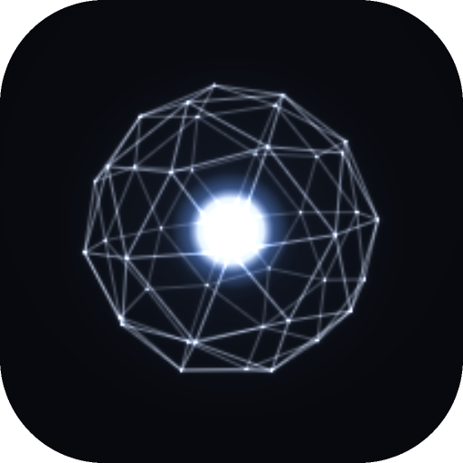</p>

<h1 align="center">Vigil</h1>

<p align="center">
  Claude Code 的狀態顯示：每個執行中的 session 是一顆多面體，用顏色和動作表示它正在做什麼。
</p>

<p align="center">
  <a href="README.md">English</a> · <b>繁體中文</b>
</p>

<p align="center">
  
  
  
  <a href="LICENSE"></a>
</p>

<p align="center">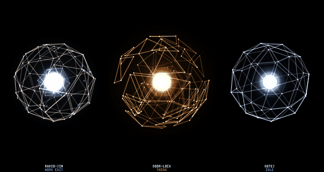</p>

同時開好幾個 Claude Code session，或讓一個在背景跑、自己去做別的事時，Vigil 會顯示哪些在思考、在執行工具、在等你核准，或已經做完。它可以開在終端機的一個窗格裡，也可以是 macOS 和 Windows 上一個永遠在最上層的小視窗。

在小視窗裡，指著某個 session 的核心就能看它最後一則回覆；雙擊核心可以直接輸入回覆。agent 做完時，不用每次都切回終端機。

Claude Code 的 hook 每個事件在檔案裡加一行；一個 C 程式讀這個檔案，用自己的渲染器畫出核心。全部在本機執行，不連網路，只需要 libc、libm 和 zlib。

<sub>舊名 dodeca-core：資料夾 `~/.dodeca-core` 和 `DODECA_*` 環境變數暫時沿用舊名。</sub>

<p align="center">
  <a href="#狀態">狀態</a> ·
  <a href="#快速開始">快速開始</a> ·
  <a href="#面板">面板</a> ·
  <a href="#隱私">隱私</a> ·
  <a href="#參考">參考</a>
</p>

## 狀態

<table>
  <tr>
    <td width="33%" align="center">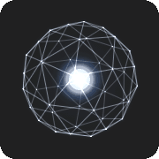<br><b>IDLE</b><br><sub>剛開始或做完之後。慢慢轉，偶爾自己做個小動作</sub></td>
    <td width="33%" align="center">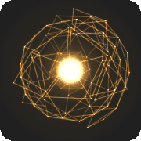<br><b>THINK</b><br><sub>送出 prompt 或工具跑完之後。琥珀色</sub></td>
    <td width="33%" align="center">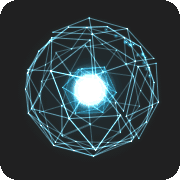<br><b>WORK</b><br><sub>工具執行中。青色，邊線上有火花</sub></td>
  </tr>
  <tr>
    <td align="center">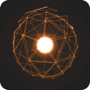<br><b>NEEDS YOU</b><br><sub>等你核准。橘色，核心閃爍</sub></td>
    <td align="center">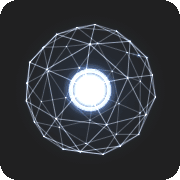<br><b>DONE</b><br><sub>Claude 回覆完畢。短暫爆開，然後回到 IDLE</sub></td>
    <td align="center">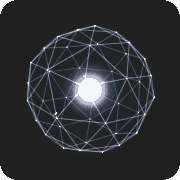<br><b>SLEEP</b><br><sub>閒置 90 秒。變暗</sub></td>
  </tr>
</table>

每個狀態有好幾種動作，每次進入時隨機挑一種（[完整列表](#參考)）。`SessionEnd` 會移除那一顆，30 分鐘沒有事件的也會移除。

## 快速開始

```sh
make
./vigil --demo                     # 假的 session；q 離開

python3 install_hooks.py           # dry run：列出 ~/.claude/settings.json 會改哪些地方
python3 install_hooks.py --apply   # 安裝 hook（會先備份你的設定）
./vigil                            # 你的 session
```

- 需要 C 編譯器、`make`、zlib 和 Python 3（只用標準函式庫）。macOS：`xcode-select --install`。WSL：`sudo apt install build-essential zlib1g-dev`。
- 能顯示影像的終端機（iTerm2、kitty、Ghostty、WezTerm）用完整解析度；其他 truecolor 終端機用半格字元。
- hook 只對安裝之後新開的 session 生效。它是用絕對路徑呼叫的，搬了這個資料夾要再跑一次 `--apply`。`--remove` 移除。
- `--rich` 會另外保留 Claude 最後一則回覆，面板的文字框和語音需要它。預設關閉，見[隱私](#隱私)。

## 面板

一個小視窗，停在其他視窗上面，不搶鍵盤焦點，除了核心以外的地方點擊都會穿過去。

```sh
sh mac/build.sh && ./vigil-panel --demo     # macOS
sh win/build.sh && ./vigil-win --demo       # Windows：在 WSL 裡執行（需要 mingw-w64）
```

<p align="center">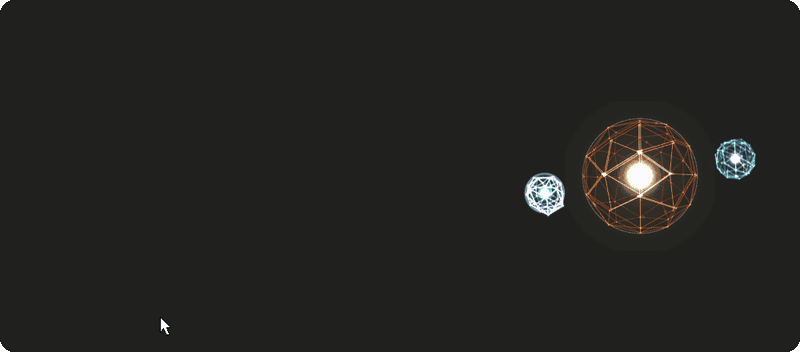<br>
<sub>指著核心會顯示它最後一則回覆，或它在等的核准。停 2 秒後對焦框會鎖定。</sub></p>

<p align="center">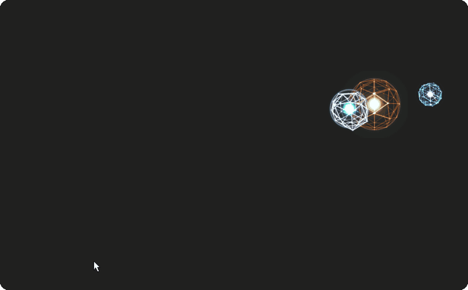<br>
<sub>滾輪捲動長回覆。雙擊打開回覆框；拖到核心上的圖片會變成 <code>[Image #1]</code>。按 Enter 送到那個 session。</sub></p>

<p align="center">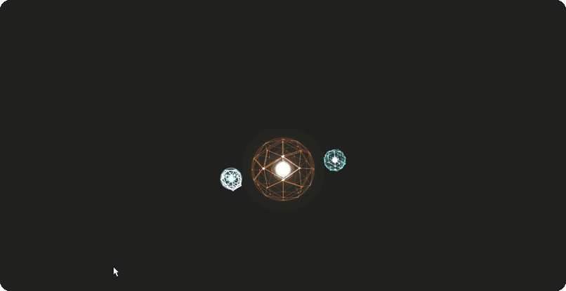<br>
<sub>Alt 點一下就能拿起核心，小核心沿著軌道跟著走。移動太快它們會掉下來，撞到螢幕邊緣彈開；把主核心移到旁邊，它就會回到軌道上。重力：Floaty。</sub></p>

- **一顆或全部。** 單核心模式是一顆大核心顯示需要你的 session（沒有的話是最新回覆的那個），其他 session 是旁邊的小核心；全部核心模式則每個 session 各自一顆。Windows 面板預設是單核心模式（`--all` 切成全部核心，每顆放在你想放的位置）；macOS 面板預設是全部核心，排在螢幕右緣一列（`--single` 或 `⌃⌥C` 切成單核心模式）。
- **回覆。** 雙擊核心、輸入、按 Enter，可以把圖片拖到核心上。macOS 也可以按住核心說話（按住說話，在 Mac 上辨識），文字會打進那個 session 的 iTerm2 窗格。
- **語音回報**（macOS，`--voice`）：點核心會念出它回覆的簡短摘要。
- **設定**（Windows：右鍵 > Settings）：形狀、光暈、大小、重力、對焦框、滾輪讓核心往哪個方向轉、文字框的字型、大小、底色和文字顏色，以及每個狀態用哪些動作，附即時預覽。Mac 也有同樣的視窗（右鍵 > Settings...），另外多了 Voice 一列；在 Mac 上滾輪仍是調語音音量，⌥ + 滾輪才會轉動核心（見下方）。

<table>
  <tr>
    <td width="50%">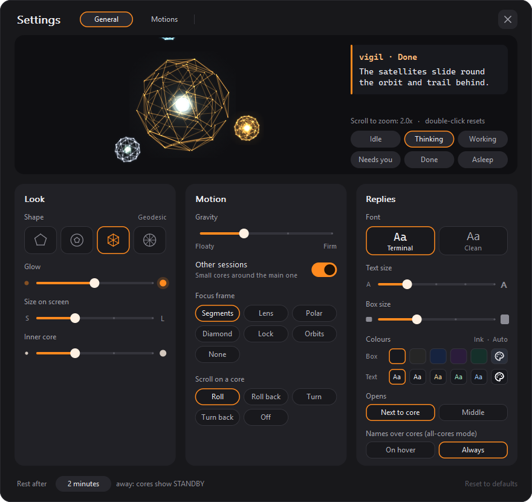</td>
    <td width="50%">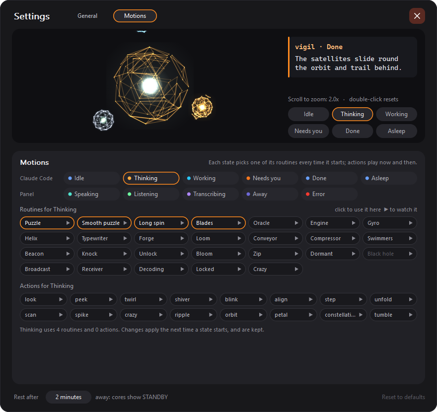 Motions：每個狀態可以跑的常駐動作和小動作"></td>
  </tr>
</table>

<p align="center"><sub>Windows 面板的設定視窗，General 與 Motions，預覽放大到 2 倍。</sub></p>

## 隱私

事件檔只有時間、session id、事件名、資料夾名稱（不含路徑）、工具名稱和通知類型，不會記錄 prompt 或工具的輸入輸出。沒有網路連線，沒有常駐程式，檔案權限是 600。

開啟 `DODECA_RICH=1`（`install_hooks.py --rich`）時，hook 另外為每個 session 保留一個檔案 `~/.dodeca-core/msg/<session id>.json`（權限 600，資料夾 700）：**Claude 最後一則回覆的文字**和最後一則通知（例如權限請求）的文字，各最多 4000 字，以及它所在終端機的 `ITERM_SESSION_ID`。新的回覆或通知會蓋掉舊的，session 結束時檔案會刪掉，沒正常結束的 session 留下的檔案 24 小時後刪除。事件檔除了 `Stop` 那行多一個 `"m": 1` 之外不變。因為回覆文字會寫到磁碟上，只在你自己的電腦上開。

語音（`vigil-panel --voice`）：語音合成在這台 Mac 上完成，按住說話的辨識強制離線，錄音不會離開這台 Mac，也不會保存。辨識出來的文字會打進它要送去的那個 Claude Code session，就像你自己打字一樣。唯一會用到網路的是 `--summarize claude`：它透過 `claude -p` 把回覆文字送給 Anthropic 來縮短。

## 參考

<details>
<summary><b>每個動作</b></summary>

| 狀態 | 觸發事件 | 畫面 |
|---|---|---|
| IDLE | `SessionStart`、完成後 | 平靜而精準的球體：白核藍暈、慢速旋轉；偶爾有一道光從底部爬到頂部，每隔幾秒會自己做點小動作（東張西望、探頭、轉圈、眨眼、把一個頂點轉向你、喀一聲轉一格、展開、掃描、冒刺、一道波紋掃過表面、一塊碎片繞著自己飛一圈、正對你的頂點周圍像花一樣綻開、一串相鄰節點依序亮起、慢慢翻轉半圈，偶爾整個發狂一下） |
| THINK | `UserPromptSubmit`、`PostToolUse` | 琥珀色。以下其中一種：**Puzzle**（外殼的一層碎片分開浮起，兩層像在解魔術方塊一樣反向轉動：快轉兩下、停一下，三次）、**Smooth puzzle**（同樣的動作但轉得平順）、**Long spin**（兩層輪流各轉三整圈）、**Blades**（單片三角形飄到核心後方，再像一排箭一樣成對掃過正面）。預設關閉、要在 Settings > Motions 打開的：**Skein**（五片三角形離開外殼變成刀鋒發光的細長刀刃，沿著一條曲線停在核心後方，再排成雁形掃過正面，到另一側停頓，然後掃回來、收回外殼） |
| WORK | `PreToolUse` | 電光青色，光點沿邊線遊走。以下其中一種：**Engine**（渦輪帶和依序推出的活塞）、**Gyro**（兩條互相垂直的帶）、**Helix**（浮起的碎片沿著轉動的外殼螺旋上升）、**Typewriter**（一排排按鍵和換行）、**Forge**（碎片發熱升起再重重敲下：火花和餘燼）、**Loom**（梭子在兩條交叉的帶上拉出光線）、**Conveyor**（兩圈輪流一格一格前進）、**Compressor**（分三下壓扁，再一口氣洩壓） |
| NEEDS YOU | `Notification`（閒置提醒除外） | 橘色，核心故障式閃爍。以下其中一種：**Swimmers**（兩條由小碎片組成的「魚」在表面下游動）、**Beacon**（像燈塔的光束，每次轉向你就閃一下）、**Knock**（朝你敲兩下，每下一圈光） |
| DONE | `Stop` | 以下其中一種：**Unlock**（蓄力、帶著尖刺和一圈光爆開、轉一整圈，碎片一片片鎖回去）、**Bloom**（像花一樣一圈圈綻開、轉一圈、收回封好）、**Zip**（拉鍊頭沿螺旋往下把碎片一片片扣上，然後火花噴出）；2.5 秒後回 IDLE（Bloom 和 Zip 稍久一點） |
| SLEEP | IDLE 超過 90 秒 | 整體變暗。以下其中一種：**Dormant**（微微縮小，每 6 秒有一道淡淡的掃描面穿過）、**Black hole**（蓄力、炸開，碎片沿螺旋落回一個帶著紫色塵盤的黑洞；指著它就會醒來） |

每次進入一個狀態時，會從它的動作中隨機挑一種（由面板的設定決定有哪些；見下面的 Motions）。外殼不會彎曲或晃動：它用喀一聲的轉動、會滑出再鎖回的三角形碎片（每次隨機切，不會重複）、相對轉動的層、整片被帶走的碎片、以及尖刺來動（一個節點被拉得很遠變成尖錐，同時另一個被拉向中心），還有火花、光軌和光圈。面板自己的狀態也會動：SPEAKING（碎片隨語音起伏）、LISTENING（正面隨麥克風張開）、TRANSCRIBING（一次轉 36° 同時掃描面在讀）、STANDBY（靜止、正對你）、ERROR（一陣一陣地發狂）。碎片需要測地線外殼（預設的 `geo2` 或 `geo3`）；`dodeca` 和 `bucky` 保持剛性的網，只有轉動、尖刺和光。

`SessionEnd` 會移除那一顆；30 分鐘沒有任何事件的 session 也會移除。

</details>

<details>
<summary><b>浮動面板（macOS）</b></summary>

`vigil-panel` 是同一套渲染核心的原生視窗版：一個沒有標題列的面板貼在螢幕右緣，不搶鍵盤、滑鼠點擊會穿過去（核心上除外，見下面）、暗的地方是透明的，所以可以浮在全螢幕的 iTerm2 上面。畫面由系統直接合成，不經過終端機。

```sh
sh mac/build.sh
./vigil-panel --demo              # 先單獨看效果，Ctrl-C 結束
```

`mac/build.sh` 會產生 `Vigil.app` 和一個小的啟動腳本 `./vigil-panel`。啟動腳本透過 macOS 啟動 App（這樣語音功能用到的麥克風和語音辨識權限算在這個 App 身上，而不是你的終端機），一直留在終端機裡直到 App 結束，選項也都一樣。Ctrl-C 或關掉那個終端機窗格兩個會一起結束。App 用 ad-hoc 簽章，每次建置都會變，所以重新建置後 macOS 會再問一次權限；不想這樣的話，在「鑰匙圈存取」建一個「程式碼簽署」憑證，之後用 `DODECA_SIGN_ID="憑證名稱" sh mac/build.sh` 建置。

建好之後，`open_pane.sh` 會自動改用它：右邊切出來的 iTerm2 窗格保持空白，只負責把那塊位置空出來，面板在裡面啟動、量出窗格的大小、蓋在正上方。關掉那個窗格面板就結束；最後一個 session 結束 15 秒後面板和窗格一起關。

- 面板只留在啟動時所在的那個 Space，也就是啟動它的那個全螢幕 iTerm2 視窗；切到別的桌面或 App 不會跟過去。
- 加 `--all-spaces` 會改成每個 Space 都出現，這時只在 iTerm2 是最前面的 App 時顯示（再加 `--always` 取消這個限制）。
- 切到沒有那個空窗格的 iTerm2 分頁時，面板仍會浮在右緣，可能蓋到文字；介意的話用 `--bg 1e1e1e` 給它實心底色。
- 手動執行時面板寬度是螢幕的 17%，用 `--width`（單位是點）和 `--top` 調整位置，`--inset` 調整第一個 session 上方的留白（預設 30）；由 `open_pane.sh` 啟動時會加 `--fit-pane`，改成跟著那個空窗格的大小。
- 字體預設 Monaco 12，用 `--font`、`--font-size` 對齊你的 iTerm2 設定。
- 想退回終端機窗格版：`export DODECA_PANE_MODE=terminal`。
- 核心會對滑鼠和快捷鍵起反應：見[互動與語音](#參考)。

</details>

<details>
<summary><b>互動與語音（macOS 面板）</b></summary>

`vigil-panel` 裡的核心會對滑鼠和一個全域快捷鍵起反應。面板仍然不會搶走 iTerm2 的鍵盤焦點，點在核心圓形外殼以外的地方也照樣傳到終端機。說話和按住說話要加 `--voice` 才會開；沒加的話，單擊只會把回覆標成已讀，長按核心沒有作用。`./vigil-panel --demo --voice` 可以用假的 session 試下面每一項（加 `--away 10` 可以很快看到待命狀態）。

| 輸入 | 動作 | 核心反應 |
|---|---|---|
| 滑鼠指著 | 0.3 秒後在面板左邊出現提示框：資料夾、狀態，以及最後一則回覆，排版和終端機裡一樣，最多 16 行（NEEDS YOU 時改顯示通知文字） | 變亮、轉慢、朝游標轉過來，並依狀態有自己的回應：IDLE 騷動（你那一側冒出緩和的尖刺）、THINK 點亮游標下的節點、WORK 的活塞推得更用力、NEEDS YOU 的魚游向你、TRANSCRIBING 的掃描面跟著你、SLEEP 和 STANDBY 醒來、ERROR 閃開 |
| 停在上面 2 秒 | — | 鎖定：停下來把一個頂點對著你，對焦框收攏（Settings > Focus frame：segments、lens、polar、diamond、lock、orbits 或 none） |
| 衝向它 | — | 只有從很遠（超過 2.2 個外殼半徑）在 0.18 秒內衝到核心上才算：碎片夾緊、朝你來的方向射出尖刺、外殼一震。WORK 時不會 |
| 有未讀回覆 | — | 規律的柔和閃光，直到你點它或送出新的 prompt |
| 單擊 | 念出回報，或停止；回覆標成已讀 | 被點的碎片凹進去，這一下會往周圍的碎片傳出去；然後 SPEAKING（青綠色） |
| 長按（> 0.35 秒）後放開 | 按住說話：說的話會在核心下方顯示 1.5 秒，然後打進那個 session 並按 Enter；這段時間內點核心可以取消 | 按住時 LISTENING（綠色、外殼停轉、光暈隨麥克風音量變大），放開後 TRANSCRIBING（紫色光點沿邊線快速繞行） |
| 雙擊 | 在核心的提示框下方打開回覆框：輸入後按 Enter 送到那個 session（Shift+Enter 換行，窗格收到時會合成一行），Esc 或右上角的 ✕ 會關閉並保留草稿；點其他地方時回覆框不會關，方便你到 Finder 或截圖縮圖上拿圖片。拖到核心或回覆框上、或用 ⌘V 貼上的圖片，會在游標處各放一個 `[Image #N]` 標記，和 Claude Code 一樣；Backspace 一次刪掉整個標記，送出時每個標記會換成圖片的路徑。Claude 還在工作時會先問你，和語音回覆一樣 | 一圈衝擊波；圖片拖到核心上方時，核心會讀取（TRANSCRIBING） |
| 右鍵 | 選單：重播、複製回覆、靜音這個 session、叫到最前面，以及 **Settings...** 設定視窗：即時預覽（可拖動核心、在上面捲動放大、按鈕切換各狀態、用文字框外觀顯示的回覆）、**Look**（形狀、光暈、螢幕上的大小、內核大小、3D 公轉和傾斜程度）、**Motion**（重力、顯示或隱藏其他 session、對焦框、⌥ + 滾輪做什麼）、**Replies**（文字框的字型、字級、框的大小、底色和文字顏色、出現位置、核心上的名稱）、**Voice**（唸出回覆、自動唸新回覆、用 Claude 摘要、送出前等點擊）和待機時間；**Motions** 分頁選擇每個狀態可以用哪些 routine 和 action（▶ 在預覽裡播放）。選擇立刻生效，存在 `~/.dodeca-core/panel-settings.json`，優先於啟動參數；Reset to defaults 會清掉它們。沒有 session 時右鍵只顯示 Settings | — |
| 拖曳 | 用手轉動多面體；邊移動邊放開會繼續轉，慢慢回到自己的轉速 | — |
| 滾輪 | 這顆核心的語音音量（在 Mac 上滾輪不會轉動核心） | 外殼短暫變粗或變細 |
| ⌥ + 滾輪 | 轉動核心：Roll（往下捲時頂部往後翻）、Roll back、Turn（繞直立軸轉）、Turn back 或 Off，依 Settings > Motion > ⌥ + scroll on a core 的設定 | 會繼續轉，再慢慢回到自己的轉速，和拖曳後一樣 |
| 錄音中按 Esc | 取消，不送出任何東西 | 光暈縮小淡出 |
| 按住 `⌃⌥V`（需 `--voice`） | 對最需要你的 session 按住說話：NEEDS YOU 優先，其次最近完成的，再其次最近活動的 | 同長按核心 |
| 2 分鐘沒有鍵盤或滑鼠輸入 | — | 除了 NEEDS YOU 以外的核心都進入 STANDBY（暗靛色）；你回來時，有未讀回覆的核心會亮一下提醒你 |

- **單核心模式**（`--single`，或隨時按 `⌃⌥C`；`--mode-hotkey` 可以換按鍵）：一顆大核心代表一個 session，其他 session 變成小核心在旁邊漂浮。每個 session 的核心會帶一點自己的顏色，一看就知道誰是誰；外殼仍保留狀態的顏色。面板會縮成只有這一團：按住 ⌥ 拖曳可以放到螢幕任何地方（或 ⌥ 點一下，它就跟著滑鼠走，再點一下放下；拿著時游標會隱藏，對焦框框住它，核心會朝移動方向傾斜、停下或轉向時稍微落後再穩住（不會彈），後側的碎片微微張開，用力甩會讓它發狂；小核心靠重力留在軌道上（Settings > Motion > Gravity，Floaty 到 Firm），拿著移動時會沿軌道滑到後方，移動太快會把它們甩飛出去：它們會繼續飛、在螢幕邊緣反彈，直到你把大核心移到它們附近；開啟 Settings > Look > 3D orbit（預設開啟，只有 Mac 有）時，軌道會傾斜並自己緩緩搖擺，轉到遠側的小核心會變小、變暗，並從大核心後面經過，滑鼠靠近整群時會放平，變回俯視；另外偶爾在大核心跑 Skein 時，刀刃會撞到小核心，讓它碎成幾塊再組回來，或直接被撞飛、一邊翻滾一邊脫離軌道，直到你把大核心移到它附近），下次會回到同一個位置（依螢幕大小存在 `~/.dodeca-core/panel-position.json`；右鍵 > Reset position 放回右緣）。點一顆小核心，它會換到中間並固定在那裡（提示框會顯示「pinned」）；右鍵 > Follow automatically 讓面板重新自動選。自動時中間那顆跟著新消息走：需要你核准的 session 優先，其次是最新有回覆的；不會只因為 session 在忙就跳來跳去。用快捷鍵按住說話時，會送給中間那顆。右鍵選單也可以切換模式。
- 在全部核心模式下，按住 `⌥` 拖曳核心可以上下調整順序：核心會跟著滑鼠，其他核心會讓出位置。⌥ 點一下可以不按住就拿起核心，再點一下放下。
- `--labels hover` 會拿掉每顆核心上方的兩行文字，面板只顯示核心（空出來的位置讓核心變大），由提示框告訴你哪顆是哪個。
- 提示框和辨識結果的預覽會出現在面板左邊、蓋在終端機上，文字會自動換行而不是被截掉；預覽會完整顯示要送出的內容。標題用那個 session 的顏色（狀態的顏色；單核心模式下是它自己的顏色），左邊有一條同色的線；內文用系統字體，大小跟著 `--font-size`，排版和 Claude Code 的終端機一樣：段落之間有空隙、`-` 項目變成圓點而且換行會對齊縮排、**粗體**、`code` 用等寬字體、程式碼區塊縮排。
- 單擊會等系統的雙擊時間過了才動作，所以雙擊不會先觸發一次單擊。
- 快捷鍵用 `RegisterEventHotKey`，不需要「輔助使用」權限。Esc 只在錄音時才攔，其他時候終端機照常收得到。`--hotkey ctrl+opt+v` 可以改按住說話的按鍵（`cmd`、`opt`、`ctrl`、`shift` 加上一個字母、數字、`space`、`return`、`tab` 或 `f1`–`f12`；`none` 關閉）。macOS 已經用掉 ⌃Space、⌃⌥Space、⌘Space 和 ⌥⌘Space，所以預設是 `⌃⌥V`。
- 是否離開是看系統提供的「距離上次輸入的秒數」（不需要「輸入監控」權限，也不記錄按鍵）。`--away 秒數` 改掉預設的 120 秒；`--away 0` 關閉。
- 送出回覆和「叫到最前面」需要 `DODECA_RICH`（iTerm2 session id 存在 msg 檔裡），第一次使用時還要允許面板控制 iTerm2（系統設定 > 隱私權與安全性 > 自動化）。

**語音回報。** 回報開頭會說來源：回覆是「notes 完成了：…」，需要你核准時是「notes 需要你：…」加上權限請求的內容。同一時間只有一個 session 在說話，其他的排隊，權限請求會插到隊伍最前面。

- 預設只有在你點核心或選「重播」時才會說話。加 `--auto-speak` 的話，如果你最近 60 秒內有用鍵盤或滑鼠，新的回覆會自動念出來；新的權限請求則會立刻念。靜音的 session 不會自己說話。
- 念的是摘要。預設是回覆的第一段，最多 3 句或 150 字（不花錢、沒有延遲）。加 `--summarize claude` 的話，面板會在背景呼叫 `claude -p`（haiku 模型，關掉 hook 和工具），請它濃縮成兩三句口語化的繁體中文；超過 15 秒就改用本地摘要。摘要會存在 msg 檔裡，重播不會再問一次。這會把回覆文字再送給 Anthropic 一次，也會用到你的 Claude Code 額度。
- 念之前，程式碼區塊會換成「（略過一段程式碼）」，Markdown 符號和網址會拿掉（連結保留文字）。
- 用的是系統設定 > 輔助使用 > 閱讀與朗讀 裡的 **系統聲音**。請選 **Siri** 的聲音：只有它念中文夾英文會自然，而且 App 只能用這個方式用到它（面板用 `say` 一句一句產生語音再播放，所以按下後大約一秒才會出聲）。`--voice-id zh-TW`（或 `en-US`、聲音識別碼）改用 App 可以直接指定的聲音：會立刻開始，面板會挑裝好的最好的那個（zh-TW 請在管理聲音下載 **美佳（高品質）**），但中文裡夾的英文會念得很差。`--rate` 設定語速（0 到 1，預設 0.5）。macOS 語言是中文時，面板自己的用語是中文。
- 說話不需要任何權限。

**語音回覆。** 按住核心（或 `⌃⌥V`）、說話、放開。

- 辨識只在這台 Mac 上進行（`SFSpeechRecognizer`，強制離線辨識），錄音不會上傳。如果那個語言沒有離線模型，按住說話會關閉，核心會說明原因。`--listen-locale` 設定語言（預設 `zh-TW`）。
- 辨識出來的文字會顯示在核心下方，1.5 秒後打進那個 session 的 iTerm2 窗格並按 Enter；在那之前點核心可以取消。加 `--confirm-send` 的話會一直等，再點一次才送出。
- 如果 Claude 還在工作，面板會先問（「還在工作中，要打斷嗎？」）並跳出選單：等這一步做完再送（Claude Code 會在目前這一步結束後讀到）、打斷再送（先按 Esc），或取消。
- 找不到窗格時，核心會變成紅色（ERROR）並說明原因。
- 錄音用系統的輸入裝置，但如果那是虛擬裝置（BlackHole、Loopback、Soundflower、Teams 或 Zoom 的音訊裝置），它傳的是別的 App 的聲音而不是你的聲音，這時會改用內建麥克風。`--mic 名稱` 可以用名稱的一部分指定裝置。錄到完全沒有聲音時，核心會說它用的是哪個裝置。
- `--debug` 會把語音的每個步驟寫到 stderr（裝置、音量、辨識錯誤、送出結果；不會寫你說的內容）。
- 送出需要 `DODECA_RICH`（session 的 `ITERM_SESSION_ID` 存在 msg 檔裡）。用的是 AppleScript，第一次會問能不能控制 iTerm2；不允許的話會改用 iTerm2 的 Python API（`pane_api.py send`）。
- `--demo` 不會打字到任何地方，核心只會說它本來會送出什麼。

**語音功能的一次性設定：**

1. `sh mac/build.sh`，然後用 `--voice` 啟動面板（`open_pane.sh` 開的窗格用 `DODECA_PANE_ARGS="--voice"`）。
2. `python3 install_hooks.py --rich --apply`，保留回覆和 iTerm2 session id（之後新開的 Claude Code session 才會生效）。
3. 第一次按住核心時，macOS 會問麥克風和語音辨識權限：兩個都允許，然後再按住一次。
4. 第一次送出回覆或選「Bring to front」時，macOS 會問 Vigil 能不能控制 iTerm2：允許（系統設定 > 隱私權與安全性 > 自動化）。
5. 選用：更好的 zh-TW 聲音（系統設定 > 輔助使用 > 朗讀內容 > 系統聲音 > 管理聲音）；iTerm2 > Settings > General > Magic > Enable Python API，當作送出的備援。
- 每種反應的樣子在 `src/session.c` 設定：`LOOKS`（SPEAKING、LISTENING、TRANSCRIBING、STANDBY 那幾列）、`HOVER` 和 `TOUCH`。

</details>

<details>
<summary><b>Windows 面板</b></summary>

在 Windows 上，請在 WSL 裡跑 Claude Code；hook 和終端機版本在那裡跟 Linux 一樣能用（`sudo apt install build-essential zlib1g-dev`，然後在 WSL 裡 `make` 和 `python3 install_hooks.py --rich --apply`）。浮動面板是原生的 Windows 程式，透過 WSL 的 `\\wsl.localhost` 共用讀同一個事件檔：

```sh
sudo apt install mingw-w64      # 只要一次，在 WSL 裡
sh win/build.sh                 # 產生 vigil-panel.exe 和啟動腳本 ./vigil-win
./vigil-win                     # 在 WSL 裡：用 ~/.dodeca-core/events.jsonl 啟動面板；Ctrl-C 結束
./vigil-win --demo              # 假的 session
```

預設是單核心模式（Mac 上要加 `--single`）：焦點 session 是一顆大核心，其他 session 以小衛星繞著它，放在一個小小的半透明視窗裡，永遠在最上層，不會搶焦點，點在核心以外的地方會傳到後面的視窗。核心會像 macOS 的單核心模式一樣跟著消息走（先是需要你的 session，否則是最新回覆的那個）；點一下核心，或用右鍵選單的 **Session**，可以把它固定住。關掉 **Show other sessions**（或 `--no-others`）就只剩大核心。`--all` 或 **Ctrl+Alt+C** 切換成所有核心：每顆核心是自己的小視窗，一開始排在右緣一列，每顆都可以各自放到任何地方。

Alt 等於 Mac 上的 ⌥：**Alt 拖曳**可以把整團（單核心）或那一顆核心（所有核心）移到螢幕任何地方；**Alt 點一下**把它拿起來，下一次在任何地方點擊就放下。位置依螢幕大小記在 `~/.dodeca-core/panel-position-win.json`（每顆核心依資料夾名稱），選單裡的 **Reset position(s)** 會把它們忘掉。

指著核心一下會出現文字框：名稱和狀態，接著是最後一則回覆，需要你的時候則是權限通知（要用 `--rich` 的 hook）。指著核心停 2 秒，或拿著它走，會畫出對焦框（六種樣式，跟 Mac 一樣）。一段時間沒有輸入（預設 2 分鐘），每顆核心都顯示 STANDBY，需要你的那顆除外；回來時，有未讀回覆的會閃一下。滑鼠滾輪在核心上可以捲動文字框裡較長的回覆（核心也會跟著轉）。

**雙擊**核心可以在文字框下方輸入回覆：Enter 送出，Shift+Enter 換行，Esc 關閉並保留草稿。把圖片檔（png、jpg、gif、webp）拖到核心或那個輸入框上就會一起送出：圖片在核心上方時核心會開始讀取（TRANSCRIBING），每張圖片會在游標處放入一個 `[Image #N]` 標記，和 Claude Code 一樣，可以像一般文字移動或刪除（Backspace 會一次刪掉整個標記）。送出時每個標記會在原處換成圖片的 WSL 路徑（`/mnt/c/...`），Claude Code 會當成圖片讀取。如果 Claude Code 在 WSL 的 tmux 裡執行，回覆會送進那個 tmux pane（`--rich` 的 hook 會記下 pane）；否則終端機會被叫到最前面，文字以一行打進去。

右鍵點核心有 **Reply**、**Copy reply** 和 **Bring to front**：這裡沒有 iTerm2，所以它會叫出標題裡有資料夾名稱的終端機或 VS Code 視窗，否則是最近用過的 Windows Terminal 視窗，但無法選到分頁。

右鍵 > **Settings...** 打開設定視窗：上方是即時預覽（叢集實際的樣子；拖動核心可以感受重力；在上面捲動滾輪可放大到 3 倍看細節，雙擊恢復；按鈕切換顯示各種狀態；一段用文字框字型和大小顯示的回覆），下方三張卡片。**Look**：形狀、光暈、螢幕上的大小、內核大小。**Motion**：在核心上捲動滾輪時怎麼轉（Roll、Roll back、Turn、Turn back 或 Off）、重力（Floaty 到 Firm：主核心把小核心拉在軌道上的力道；搬動時它們沿著軌道滑到後方跟著走，用力甩出去會在螢幕邊緣反彈）、顯示或隱藏其他 session、對焦框。**Replies**：文字框的顏色：Box（五種深色）和 Text（Auto、White、Cream、Mint、Sky），兩列各有一格調色盤，可以打開 Windows 的色彩視窗挑任何顏色（Auto 時，淺色框上的文字會變深色）；文字框大小；字型（終端機的等寬字型，讓回覆排列和 Claude Code 裡一樣，中文用微軟正黑體、每字佔兩格，和 Windows Terminal 相同；或 Segoe UI；回覆輸入框一律用終端機字型）、文字大小、出現的位置（核心旁邊，或螢幕中間），以及所有核心模式下核心上方的名稱。

**Motions** 頁（上方的切換）為每個狀態選擇可以跑哪些常駐動作（每次進入狀態時挑一種；任何動作都可以給任何狀態，只有黑洞限睡眠時使用），以及沒被碰時偶爾做哪些小動作；按小卡上的 **▶** 會在預覽裡播放。最下面是多久沒操作後核心休息（STANDBY），以及 **Reset to defaults**。選了立刻生效，記在 `~/.dodeca-core/panel-settings-win.json`，在重設之前優先於啟動選項；按 Esc 關閉視窗。

其他也都有：所有動作、鎖定、衝撞防禦、按壓、拖曳轉動、雙擊光圈。還沒有：語音；iTerm2 相關功能在 Windows 上沒有對應。Windows Terminal 無法顯示 kitty 或 iTerm2 的影像，所以終端機版本在那裡用半格字元繪製。

</details>

<details>
<summary><b>iTerm2 側邊窗格</b></summary>

`--pane` 是給窄窗格用的直排版面：session 由上到下，每個先兩行文字（名稱、狀態），下面才是多面體。文字用的是終端機本身的字體，所以跟同一個 profile 的其他窗格一樣大。

```sh
./vigil --pane --demo                # 在一個窄窗格裡先看效果
python3 install_hooks.py --pane --apply    # 之後每次開 Claude Code 自動開窗格
```

加了 `--pane` 安裝之後，`SessionStart` 會多執行 `open_pane.sh`：把 Claude Code 所在的窗格往右切一塊跑 `vigil --pane --exit-when-empty`，縮到 34 個字元寬，再把鍵盤焦點還給 Claude Code。已經有窗格開著就不會再開；最後一個 session 結束 15 秒後窗格自己關掉。

- 窗格寬度：環境變數 `DODECA_PANE_COLS`（預設 34）。
- 縮窄窗格要靠 iTerm2 的 Python API（`pane_api.py`）：AppleScript 能切窗格，但在全螢幕視窗裡不能調寬度。需要兩個一次性步驟：在 iTerm2 的 Settings > General > Magic 勾選 Enable Python API；再把腳本複製到 iTerm2 找腳本的資料夾：`mkdir -p ~/Library/Application\ Support/iTerm2/Scripts && cp pane_api.py ~/Library/Application\ Support/iTerm2/Scripts/vigil_pane.py`（之後 `open_pane.sh` 會自動保持這份複本是最新的）。沒設定的話窗格會是一半寬，可以自己拖分隔線，面板會跟著變。
- 除錯：`DODECA_PANE_DEBUG=1 sh open_pane.sh` 會在前景執行並顯示 iTerm2 的回應。
- 額外參數：環境變數 `DODECA_PANE_ARGS`，例如 `"--shape geo2 --res 1200"`。
- 第一次執行時 macOS 會問是否允許控制 iTerm2，要按允許。
- 不用自動開的話，自己切一個窗格跑 `./vigil --pane` 也一樣。

</details>

<details>
<summary><b>輸出方式</b></summary>

程式先在記憶體裡畫出一張 RGB 影像，再用三種方式之一送到終端機，啟動時會自動偵測：

| 模式 | 說明 |
|---|---|
| `--kitty` | kitty graphics protocol，真像素。終端機回應支援時優先使用 |
| `--iterm` | iTerm2 inline image（PNG），真像素。在 iTerm2 裡且不支援上一種時使用 |
| `--cells` | 半格字元 `▀`，每個字元格兩顆像素。任何 truecolor 終端機都能用，但很粗；tmux 裡固定用這個 |

自動偵測的結果不理想時可以用參數強制指定。

</details>

<details>
<summary><b>選項</b></summary>

```
--pane            側邊窗格的直排版面
--exit-when-empty 沒有 session 超過 15 秒就結束
--demo [N]        用 N 個假 session（1-6，預設 3）
--shape NAME      dodeca | bucky | geo2（預設）| geo3
--res N           影像最長邊的像素數（預設 960，`--pane` 時 420；越大越細但終端機負擔越重）
--fps N           每秒最多幾格（預設 20；平靜的 session 會自動降低重畫頻率）
--glow X          光暈強度（預設 1.0）
--core X          核心半徑，占外殼內切球半徑的比例（預設 0.35）
--events PATH     事件檔（預設 ~/.dodeca-core/events.jsonl，或環境變數 DODECA_EVENTS）
--snapshot FILE   輸出一張 demo 畫面成 PPM 檔後結束（搭配 --at 秒數、--size 寬x高）
```

</details>

<details>
<summary><b>架構</b></summary>

```
Claude Code ──hook.py──▶ ~/.dodeca-core/events.jsonl ──tail──▶ 狀態機 ──▶ 軟體渲染 ──▶ 終端機
```

| 檔案 | 內容 |
|---|---|
| `mac/panel.m` | 浮動面板：Cocoa 視窗、文字標籤、把畫布轉成透明影像 |
| `pane_api.py` | 用 iTerm2 Python API 切窗格並設定寬度 |
| `open_pane.sh` | `SessionStart` hook：在 iTerm2 裡自動切出側邊窗格 |
| `hook.py` | 每個事件 append 一行 JSON：時間、session id、事件名、資料夾名、工具名、通知類型 |
| `src/events.c` | 跟著事件檔讀新增的行 |
| `src/session.c` | 事件對應到狀態，以及每個狀態的外觀參數表 `LOOKS` |
| `src/geom.c` | 產生正十二面體、截角二十面體、測地球的頂點與邊 |
| `src/render.c` | 把線條、光暈、核心、標籤畫進 float RGB 畫布 |
| `src/motion.c` | 每個狀態怎麼動：轉動、碎片、尖刺、每種動作一個 routine、閒置時的小動作 |
| `win/panel.c` | Windows 面板：分層視窗、軌道物理、設定視窗 |
| `src/main.c` | 主迴圈、終端機設定、三種輸出方式、demo |

顏色在 `src/session.c` 的 `LOOKS` 表；每個狀態怎麼動是 `src/motion.c` 裡的 routine。

</details>

<details>
<summary><b>已知限制</b></summary>

- 權限請求核准之後，Claude Code 不會再送一次事件，所以那個工具執行期間仍顯示 NEEDS YOU，要等工具跑完才會切走。
- 標籤用的是內建的 3×5 點陣字，只有英數和少數符號；資料夾名稱裡的中文會顯示成 `?`。

</details>

## 致謝與授權

Vigil 由 **Zaviel**（[zelvet-velvet](https://github.com/zelvet-velvet)）開發：活的核心與 Core Bestiary 動作、Windows 面板、單核心模式與拿著走、各種互動、語音，以及設定視窗。

它源自 **Shang-En Hsu**（[Ehsu745](https://github.com/Ehsu745/dodeca-core-cc-status)）的 **dodeca-core**：最早的多面體渲染、終端機輸出方式、第一版 macOS 浮動面板和 iTerm2 側邊窗格都來自 dodeca-core。dodeca-core 本身又以 Zaviel 的 [clawd-room](https://github.com/zelvet-velvet/clawd-room) 為起點：`hook.py`、`install_hooks.py` 和 `src/events.c` 的事件讀取改寫自它。

MIT 授權；[LICENSE](LICENSE) 保留兩行版權聲明。
