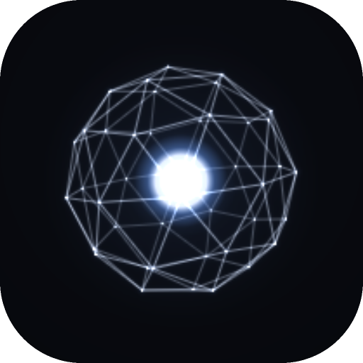
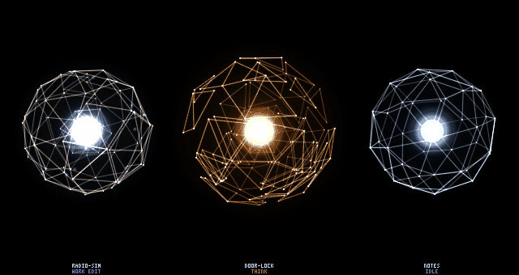
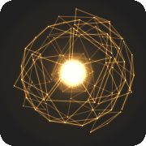
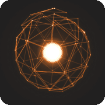
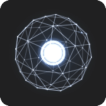
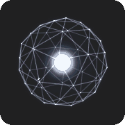
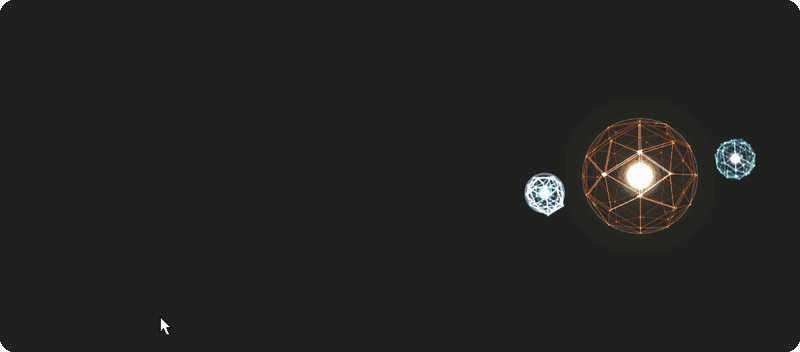
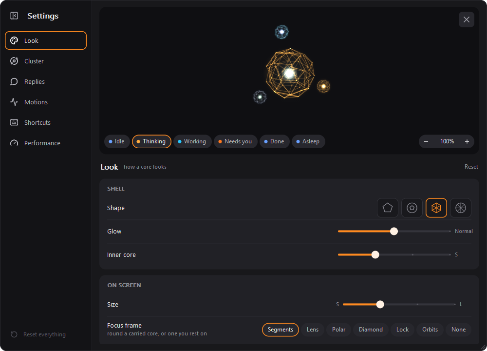
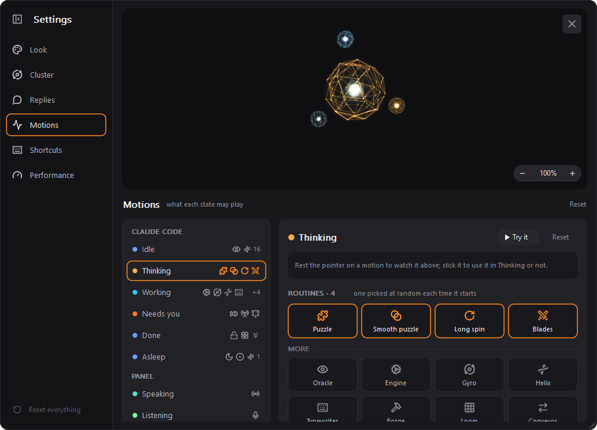

<p align="center"></p>

<h1 align="center">Vigil</h1>

<p align="center">
  Claude Code 的狀態顯示：每個執行中的 session 是一顆多面體，用顏色和動作表示它正在做什麼。
</p>

<p align="center">
  <a href="README.md">English</a> · <b>繁體中文</b>
</p>

<p align="center">
  
  
  
  <a href="LICENSE"></a>
</p>

<p align="center"></p>

同時開好幾個 Claude Code session，或讓一個在背景跑、自己去做別的事時，Vigil 會顯示哪些在思考、在執行工具、在等你核准，或已經做完。它可以開在終端機的一個窗格裡，也可以是 macOS 和 Windows 上一個永遠在最上層的小視窗。

在小視窗裡，指著某個 session 的核心就能看它最後一則回覆；雙擊核心可以直接輸入回覆。agent 做完時，不用每次都切回終端機。

Claude Code 的 hook 每個事件在檔案裡加一行；一個 C 程式讀這個檔案，用自己的渲染器畫出核心。全部在本機執行，不連網路，只需要 libc、libm 和 zlib。

<sub>舊名 dodeca-core：資料夾 `~/.dodeca-core` 和 `DODECA_*` 環境變數暫時沿用舊名。</sub>

<p align="center">
  <a href="#狀態">狀態</a> ·
  <a href="#快速開始">快速開始</a> ·
  <a href="#面板">面板</a> ·
  <a href="#隱私">隱私</a> ·
  <a href="#參考">參考</a>
</p>

## 狀態

<table>
  <tr>
    <td width="33%" align="center"><br><b>IDLE</b><br><sub>剛開始或做完之後。慢慢轉，偶爾自己做個小動作</sub></td>
    <td width="33%" align="center"><br><b>THINK</b><br><sub>送出 prompt 或工具跑完之後。琥珀色</sub></td>
    <td width="33%" align="center"><br><b>WORK</b><br><sub>工具執行中。青色，邊線上有火花</sub></td>
  </tr>
  <tr>
    <td align="center"><br><b>NEEDS YOU</b><br><sub>等你核准。橘色，核心閃爍</sub></td>
    <td align="center"><br><b>DONE</b><br><sub>Claude 回覆完畢。短暫爆開，然後回到 IDLE</sub></td>
    <td align="center"><br><b>SLEEP</b><br><sub>閒置 90 秒。變暗</sub></td>
  </tr>
</table>

每個狀態有好幾種動作，每次進入時隨機挑一種（[完整列表](#參考)）。`SessionEnd` 會移除那一顆，30 分鐘沒有事件的也會移除。

## 快速開始

```sh
make
./vigil --demo                     # 假的 session；q 離開

python3 install_hooks.py           # dry run：列出 ~/.claude/settings.json 會改哪些地方
python3 install_hooks.py --apply   # 安裝 hook（會先備份你的設定）
./vigil                            # 你的 session
```

- 需要 C 編譯器、`make`、zlib 和 Python 3（只用標準函式庫）。macOS：`xcode-select --install`。WSL：`sudo apt install build-essential zlib1g-dev`。
- 能顯示影像的終端機（iTerm2、kitty、Ghostty、WezTerm）用完整解析度；其他 truecolor 終端機用半格字元。
- hook 只對安裝之後新開的 session 生效。它是用絕對路徑呼叫的，搬了這個資料夾要再跑一次 `--apply`。`--remove` 移除。
- `--rich` 會另外保留 Claude 最後一則回覆和最近幾輪對話（你的提示、回覆和簡短的步驟說明），面板的對話框和語音需要它。預設關閉，見[隱私](#隱私)。

## 面板

一個小視窗，停在其他視窗上面，不搶鍵盤焦點，除了核心以外的地方點擊都會穿過去。

```sh
sh mac/build.sh && ./vigil-panel --demo     # macOS
sh win/build.sh && ./vigil-win --demo       # Windows：在 WSL 裡執行（需要 mingw-w64）
```

<p align="center"><br>
<sub>指著核心會顯示它最後一則回覆，或它在等的核准。停 2 秒後對焦框會鎖定。</sub></p>

<p align="center"><br>
<sub>滾輪捲動長回覆。雙擊打開回覆框；拖到核心上的圖片會變成 <code>[Image #1]</code>。按 Enter 送到那個 session。</sub></p>

<p align="center"><br>
<sub>Alt 點一下就能拿起核心，小核心沿著軌道跟著走。移動太快它們會掉下來，撞到螢幕邊緣彈開；把主核心移到旁邊，它就會回到軌道上。重力：Floaty。</sub></p>

- **一顆或全部。** 單核心模式是一顆大核心顯示需要你的 session（沒有的話是最新回覆的那個），其他 session 是旁邊的小核心；全部核心模式則每個 session 各自一顆。Windows 面板預設是單核心模式（`--all` 切成全部核心，每顆放在你想放的位置）；macOS 面板預設是全部核心，排在螢幕右緣一列（`--single` 或 `⌃⌥C` 切成單核心模式）。
- **回覆。** 雙擊核心、輸入、按 Enter，可以把圖片拖到核心上。macOS 也可以按住核心說話（按住說話，在 Mac 上辨識），文字會打進那個 session 的 iTerm2 窗格。
- **語音回報**（macOS，`--voice`）：點核心會念出它回覆的簡短摘要。
- **設定**（Windows：右鍵 > Settings）：可以調整大小的視窗，附可放大的即時預覽和六頁（Look、Cluster、Replies、Motions、Shortcuts、Performance）：形狀、光暈、大小、重力、對焦框、對話框的字型和顏色、每個狀態用哪些動作，以及可以自己錄的全域快捷鍵。Mac 也有類似但較簡單的視窗（右鍵 > Settings...），另外多了 Voice 一列；在 Mac 上滾輪仍是調語音音量，⌥ + 滾輪才會轉動核心（見下方）。

<table>
  <tr>
    <td width="50%"> Look：各頁的側欄、即時預覽，和一列列的設定"></td>
    <td width="50%"> Motions：每個狀態和它的常駐動作，以及選中狀態的常駐動作和小動作"></td>
  </tr>
</table>

<p align="center"><sub>Windows 面板的設定視窗：Look 與 Motions。</sub></p>

## 隱私

- 事件檔只有時間、session id、事件名、資料夾名稱（不含路徑）、工具名稱和通知類型，以及子代理的 id 和類型。不會記錄 prompt 或工具的輸入輸出。
- 不連網路，沒有常駐程式；檔案權限 600，資料夾 700。
- **Rich 模式**（`install_hooks.py --rich`）會為每個 session 另外保留 Claude 最後一則回覆、最近 5 輪對話（你的提示、回覆、簡短的步驟說明）和它所在的終端機，給對話框和語音用。session 結束時刪除。只在你自己的電腦上開。
- **語音**（macOS）的辨識和合成都在 Mac 上完成；只有 `--summarize claude` 會把回覆文字送給 Anthropic。

完整細節：[docs/reference.zh-TW.md](docs/reference.zh-TW.md#rich-模式與隱私細節)。

## 參考

[docs/reference.zh-TW.md](docs/reference.zh-TW.md) 列出每個狀態的動作、各面板的每種操作、命令列參數、輸出模式和檔案。

## 致謝與授權

Vigil 由 **Zaviel**（[zelvet-velvet](https://github.com/zelvet-velvet)）開發：活的核心與 Core Bestiary 動作、Windows 面板、單核心模式與拿著走、各種互動、語音，以及設定視窗。

它源自 **Shang-En Hsu**（[Ehsu745](https://github.com/Ehsu745/dodeca-core-cc-status)）的 **dodeca-core**：最早的多面體渲染、終端機輸出方式、第一版 macOS 浮動面板和 iTerm2 側邊窗格都來自 dodeca-core。dodeca-core 本身又以 Zaviel 的 [clawd-room](https://github.com/zelvet-velvet/clawd-room) 為起點：`hook.py`、`install_hooks.py` 和 `src/events.c` 的事件讀取改寫自它。黑洞的外觀參照 Mayank 的 [blackhole-simulation](https://github.com/steeltroops-ai/blackhole-simulation)（MIT）：它的光線追蹤、吸積盤和光環移植成 C（`src/render.c` 的 `bh2_*`），`web/blackhole-mock.html` 則把它的 shader 和我們的並排執行以便調整。

MIT 授權；[LICENSE](LICENSE) 保留兩行版權聲明。
